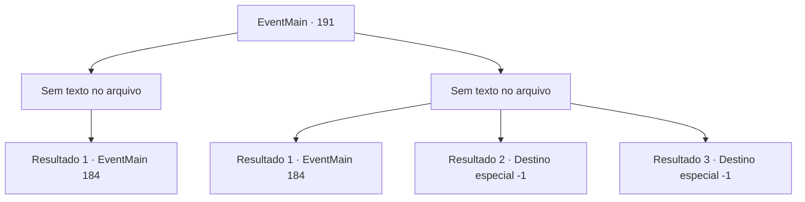

# Eventos principais · 191

[Índice da tabela](index.md) · [Índice geral](../index.md)

ID: `pt:EventMain:191` · Fonte: `EventMain4` · Versão: 1.2.47.

Mapeamento estático dos arquivos; a disponibilidade e a execução dependem do estado da run.

## Texto do evento

*Sem texto no arquivo.*

## Dados de entrada

```json
{
  "id": 191,
  "grade": 1,
  "normalGoal": "",
  "required": ""
}
```

## Mapa das escolhas



## Escolhas e resultados

### Escolha 1

*Sem texto no arquivo; o papel dessa opção depende da interface do jogo.*

Requisitos e outros campos da escolha:

```json
{
  "required": ""
}
```

#### Resultado 1.1

Você manda Halad rolar pelo chão da caverna. Ela está extremamente chateada por você estar ganhando. 

 "Você...! Você está desperdiçando minha energia, idiota."

 De repente, Edmond emerge de um portal próximo. Halad se teletransporta para o topo do colosso de carne. Então ela se torna um com ele. Seu grito perfura seus ouvidos. 

 "Eu não queria fazer isso, mas vou ter que esmagar vocês dois!!"

 O colosso fica de pé, ventos de fedor entorpecente soprando em todas as direções. Edmond explica a você sobre a fera por trás. 

 "Um colosso é imune à maioria das magias. Você precisa distraí-lo para mim enquanto eu preparo um longo feitiço."


Continuação registrada: [Evento 184](0184.md) na mesma tabela.

```json
{
  "required": "",
  "chance": "1",
  "nextEvent": 184,
  "type": 2,
  "reward": "6_2_83",
  "place": 6
}
```

### Escolha 2

*Sem texto no arquivo; o papel dessa opção depende da interface do jogo.*

Requisitos e outros campos da escolha:

```json
{
  "required": ""
}
```

#### Resultado 2.1

Halad está muito perto de matá-lo. De repente, um portal se abre na caverna. Edmond emerge dela, como você esperava. 'Droga, eu quase o peguei...' murmura Halad, enquanto ela se teletransporta para o topo do colosso de carne. Então ela se torna um com ele. Seu grito perfura seus ouvidos. 

 "Eu não queria fazer isso, mas vou ter que esmagar vocês dois!!"

 O colosso fica de pé, ventos de fedor entorpecente soprando em todas as direções. Edmond explica a você sobre a fera por trás. 

 "Um colosso é imune à maioria das magias. Você precisa distraí-lo para mim enquanto eu preparo um longo feitiço."


Continuação registrada: [Evento 184](0184.md) na mesma tabela.

```json
{
  "required": "1_0_2|1_1_2",
  "chance": "1",
  "nextEvent": 184,
  "type": 2,
  "reward": "0_0_-1|0_1_-1|6_0_83|0_2_1",
  "place": 6
}
```

#### Resultado 2.2

Você está nocauteado. Edmond chega em um portal logo depois, mas você já está morto.

Continuação registrada: [Destino especial `-1`](../destinos-especiais.md).

```json
{
  "required": "2_0_2",
  "chance": "1",
  "nextEvent": -1,
  "type": 2,
  "reward": "0_0_-1|0_1_-1|15_2_14|25_8_1"
}
```

#### Resultado 2.3

Você está nocauteado. Edmond chega em um portal logo depois, mas você já está morto.

Continuação registrada: [Destino especial `-1`](../destinos-especiais.md).

```json
{
  "required": "2_1_2",
  "chance": "1",
  "nextEvent": -1,
  "type": 2,
  "reward": "0_0_-1|0_1_-1|15_2_14|25_8_1"
}
```

## Referências que chegam a este evento

- [Evento 190 · escolha 1 · resultado 1](0190.md#escolha-1)
- [Evento 190 · escolha 2 · resultado 1](0190.md#escolha-2)
- [Evento 211 · escolha 1 · resultado 1](0211.md#escolha-1)
- [Evento 211 · escolha 2 · resultado 1](0211.md#escolha-2)
