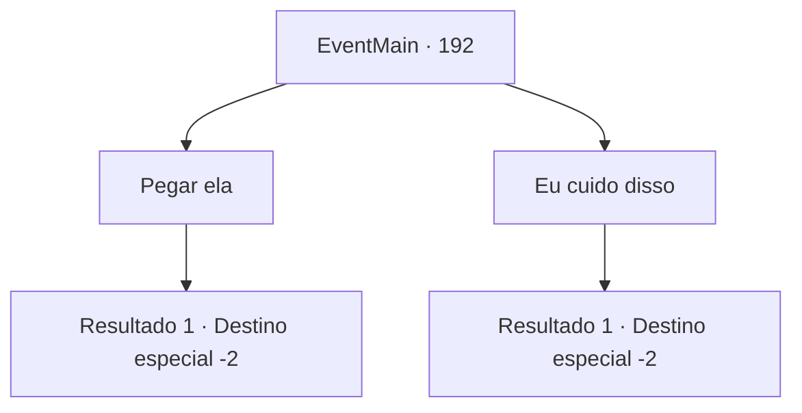

# Eventos principais · 192

[Índice da tabela](index.md) · [Índice geral](../index.md)

ID: `pt:EventMain:192` · Fonte: `EventMain4` · Versão: 1.2.47.

Mapeamento estático dos arquivos; a disponibilidade e a execução dependem do estado da run.

## Texto do evento

*Sem texto no arquivo.*

## Dados de entrada

```json
{
  "id": 192,
  "grade": 1,
  "normalGoal": "",
  "required": ""
}
```

## Mapa das escolhas



## Escolhas e resultados

### Escolha 1

Pegar ela

Requisitos e outros campos da escolha:

```json
{
  "required": ""
}
```

#### Resultado 1.1

Você pede a Edmond para levar Halad com ele. Ele acena com a cabeça enquanto comenta. 

 "Sua raiva contra ela é completamente justificada. Devíamos ter acreditado em você para começar... sentimos muito. Vamos chegar ao fundo desta vez. Vejo você na Torre da Magia."

 Edmond abre um portal e leva Halad com ele. Você sai lentamente da caverna.

Continuação registrada: [Destino especial `-2`](../destinos-especiais.md).

```json
{
  "required": "",
  "chance": "1",
  "nextEvent": -2,
  "type": 2,
  "reward": "13_1_23"
}
```

### Escolha 2

Eu cuido disso

Requisitos e outros campos da escolha:

```json
{
  "required": "1_3_0|1_14_10"
}
```

#### Resultado 2.1

Você bola um plano para fazer Halad pagar. Primeiro, diga a Edmond que gostaria de levá-la. Ele pensa por um momento antes de assentir. 

 "Tudo bem... Eu vou deixar os professores saberem. Devíamos ter acreditado em você para começar... sentimos muito. Por favor, passe na Torre da Magia quando encontrar tempo."

 Surpreso, Halad pergunta a você. 

 "O que você está fazendo, idiota?"


Continuação registrada: [Destino especial `-2`](../destinos-especiais.md).

```json
{
  "required": "",
  "chance": "1",
  "nextEvent": -2,
  "type": 2,
  "reward": "13_1_26"
}
```

## Referências que chegam a este evento

- [Evento 186 · escolha 2 · resultado 1](0186.md#escolha-2)
