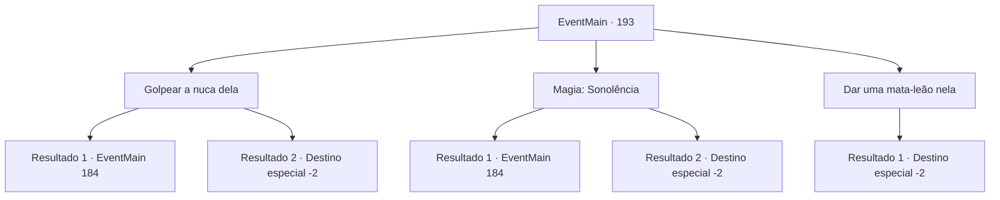

# Eventos principais · 193

[Índice da tabela](index.md) · [Índice geral](../index.md)

ID: `pt:EventMain:193` · Fonte: `EventMain4` · Versão: 1.2.47.

Mapeamento estático dos arquivos; a disponibilidade e a execução dependem do estado da run.

## Texto do evento

*Sem texto no arquivo.*

## Dados de entrada

```json
{
  "id": 193,
  "grade": 1,
  "normalGoal": "",
  "required": ""
}
```

## Mapa das escolhas



## Escolhas e resultados

### Escolha 1

Golpear a nuca dela

Requisitos e outros campos da escolha:

```json
{
  "required": ""
}
```

#### Resultado 1.1

Você bate na nuca de Halad o mais forte que pode. Não a nocauteia como você pensou que faria. 

 "AHH! O que..!!"

 Halad fica furioso. Ela se teletransporta para o topo do colosso de carne. Então ela se torna um com ele. Seu grito perfura seus ouvidos. 

 "Eu não queria fazer isso, mas vou ter que esmagar vocês dois!!"

 O colosso fica de pé, ventos de fedor entorpecente soprando em todas as direções. Edmond explica a você sobre a fera por trás. 

 "Um colosso é imune à maioria das magias. Você precisa distraí-lo para mim enquanto eu preparo um longo feitiço."


Continuação registrada: [Evento 184](0184.md) na mesma tabela.

```json
{
  "required": "",
  "chance": "11",
  "nextEvent": 184,
  "type": 1,
  "reward": "6_2_83",
  "place": 6
}
```

#### Resultado 1.2

Você bate na nuca de Halad o mais forte que pode. Isso a derruba e ela cai no chão. Edmond imediatamente explode o fanático ao lado dela. 

 "Movimento inteligente... bem jogado. Agora... tudo o que precisamos fazer é encontrar aquele texto proibido."

 Você segue Edmond até a pequena sala. |drawing_forbidenBook| Dentro há uma mesa de madeira e uma cadeira, uma pequena vela e um livro velho e surrado que está aberto. Você imediatamente o reconhece como o texto proibido de Halad. Edmond está prestes a destruí-lo quando começa a falar. 

 "He-hey, Edmond, eu... eu fui manipulado! Apenas me dê uma última chance, vamos lá."

 O livro tenta ser amigável, mas não adianta. A varinha de Edmond brilha alaranjada com chamas, queimando-a em pedacinhos. Toda a energia que acumulou das almas encantadas explode em várias direções. 

 "Ufa... acabou agora. Tudo graças a você. Voltemos..."

 Ele balança Halad por cima do ombro e abre um pequeno portal. Ele olha para você enquanto entra. 

 "Estarei esperando na Torre da Magia. Desculpe, este portal só pode transportar duas pessoas ao mesmo tempo. Sem pressa."

 Edmond e Halad desaparecem no portal, e você sai lentamente da caverna.

Continuação registrada: [Destino especial `-2`](../destinos-especiais.md).

```json
{
  "required": "",
  "chance": "1|0_5_1",
  "nextEvent": -2,
  "type": 0,
  "reward": "13_1_23"
}
```

### Escolha 2

Magia: Sonolência

Requisitos e outros campos da escolha:

```json
{
  "required": "20_0_2|1_1_2"
}
```

#### Resultado 2.1

Você lançou um feitiço de sono em Halad. Mas não é forte o suficiente para se infiltrar em sua mente, e ela se vira para olhar para você. 

 "Seu idiota... Como você se atreve!"

 Halad fica furioso. Ela se teletransporta para o topo do colosso de carne. Então ela se torna um com ele. Seu grito perfura seus ouvidos. 

 "Eu não queria fazer isso, mas vou ter que esmagar vocês dois!!"

 O colosso fica de pé, ventos de fedor entorpecente soprando em todas as direções. Edmond explica a você sobre a fera por trás. 

 "Um colosso é imune à maioria das magias. Você precisa distraí-lo para mim enquanto eu preparo um longo feitiço."


Continuação registrada: [Evento 184](0184.md) na mesma tabela.

```json
{
  "required": "",
  "chance": "28",
  "nextEvent": 184,
  "type": 1,
  "reward": "6_0_83|0_1_-1",
  "place": 6
}
```

#### Resultado 2.2

Você lançou um feitiço de sono em Halad. Ela percebe, mas não rápido o suficiente para bloqueá-lo. 

 "Você... d.. weeeb..."

 Ela cai no chão, dormindo profundamente. Edmond imediatamente explode o fanático ao lado dela. 

 "Movimento inteligente... bem jogado. Agora... tudo o que precisamos fazer é encontrar aquele texto proibido."

 Você segue Edmond até a pequena sala. |drawing_forbidenBook| Dentro há uma mesa de madeira e uma cadeira, uma pequena vela e um livro velho e surrado que está aberto. Você imediatamente o reconhece como o texto proibido de Halad. Edmond está prestes a destruí-lo quando começa a falar. 

 "He-hey, Edmond, eu... eu fui manipulado! Apenas me dê uma última chance, vamos lá."

 O livro tenta ser amigável, mas não adianta. A varinha de Edmond brilha alaranjada com chamas, queimando-a em pedacinhos. Toda a energia que acumulou das almas encantadas explode em várias direções. 

 "Ufa... acabou agora. Tudo graças a você. Voltemos..."

 Ele balança Halad por cima do ombro e abre um pequeno portal. Ele olha para você enquanto entra. 

 "Estarei esperando na Torre da Magia. Desculpe, este portal só pode transportar duas pessoas ao mesmo tempo. Sem pressa."

 Edmond e Halad desaparecem no portal, e você sai lentamente da caverna.

Continuação registrada: [Destino especial `-2`](../destinos-especiais.md).

```json
{
  "required": "",
  "chance": "1|0_7_1|0_12_1",
  "nextEvent": -2,
  "type": 0,
  "reward": "13_1_23|0_1_-1"
}
```

### Escolha 3

Dar uma mata-leão nela

Requisitos e outros campos da escolha:

```json
{
  "required": "1_6_15"
}
```

#### Resultado 3.1

Você usa sua melhor habilidade não letal contra Halad. Isso a derruba e ela cai no chão. Edmond imediatamente explode o fanático ao lado dela. 

 "Movimento inteligente... bem jogado. Agora... tudo o que precisamos fazer é encontrar aquele texto proibido."

 Você segue Edmond até a pequena sala. |drawing_forbidenBook| Dentro há uma mesa de madeira e uma cadeira, uma pequena vela e um livro velho e surrado que está aberto. Você imediatamente o reconhece como o texto proibido de Halad. Edmond está prestes a destruí-lo quando começa a falar. 

 "He-hey, Edmond, eu... eu fui manipulado! Apenas me dê uma última chance, vamos lá."

 O livro tenta ser amigável, mas não adianta. A varinha de Edmond brilha alaranjada com chamas, queimando-a em pedacinhos. Toda a energia que acumulou das almas encantadas explode em várias direções. 

 "Ufa... acabou agora. Tudo graças a você. Voltemos..."

 Ele balança Halad por cima do ombro e abre um pequeno portal. Ele olha para você enquanto entra. 

 "Estarei esperando na Torre da Magia. Desculpe, este portal só pode transportar duas pessoas ao mesmo tempo. Sem pressa."

 Edmond e Halad desaparecem no portal, e você sai lentamente da caverna.

Continuação registrada: [Destino especial `-2`](../destinos-especiais.md).

```json
{
  "required": "",
  "chance": "1",
  "nextEvent": -2,
  "type": 2,
  "reward": "13_1_23"
}
```

## Referências que chegam a este evento

- [Evento 190 · escolha 1 · resultado 2](0190.md#escolha-1)
- [Evento 211 · escolha 1 · resultado 2](0211.md#escolha-1)
