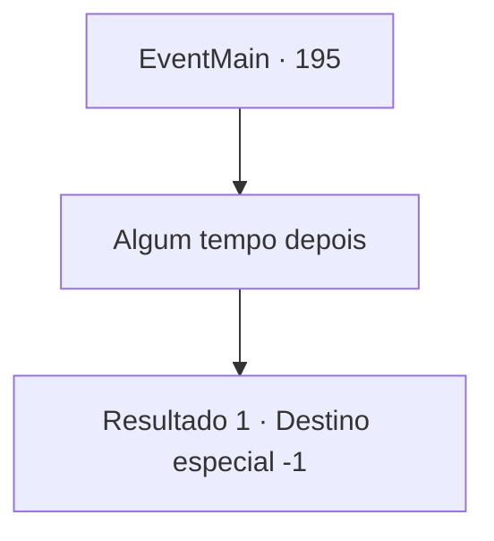

# Eventos principais · 195

[Índice da tabela](index.md) · [Índice geral](../index.md)

ID: `pt:EventMain:195` · Fonte: `EventMain4` · Versão: 1.2.47.

Mapeamento estático dos arquivos; a disponibilidade e a execução dependem do estado da run.

## Texto do evento

|drawing_floatingTower|  Você volta para a Torre da Magia. Edmond o cumprimenta com um sorriso.  

 "Bem-vindo. Nós estávamos esperando por você."

  Ele leva você para o quarto dele e pede para você esperar lá.  Assim que você se senta no sofá, a xícara de chá na mesa se enche automaticamente de chá.  Edmond sai, dizendo que voltará em breve. Você decide se deitar no sofá por um tempo.

## Dados de entrada

```json
{
  "id": 195,
  "grade": 1,
  "normalGoal": "//하라드 죽음",
  "required": "13_1_24|1_2_100"
}
```

## Mapa das escolhas



## Escolhas e resultados

### Escolha 1

Algum tempo depois

Requisitos e outros campos da escolha:

```json
{
  "required": ""
}
```

#### Resultado 1.1

Algum tempo depois, Edmond e alguns outros professores entram na sala. Edmond pega um pergaminho e o lê em nome de todos. 

 "Expressamos nossas mais sinceras desculpas por nossa decisão errônea de excomungar {1}. Por meio deste, concedemos a você o direito de se juntar à Torre da Magia como estudante sem nenhum custo adicional. Mais uma vez, lamentamos profundamente."

 Os professores abaixam a cabeça em desculpas quando Edmond termina. Você é mais uma vez um estudioso da Torre da Magia.

Continuação registrada: [Destino especial `-1`](../destinos-especiais.md).

```json
{
  "required": "",
  "chance": "1",
  "nextEvent": -1,
  "type": 2,
  "reward": "15_2_16"
}
```

## Referências que chegam a este evento

Nenhum `nextEvent` positivo da mesma tabela aponta para este nó. Isso não prova que seja inacessível: sorteio e estado de história podem selecioná-lo.

