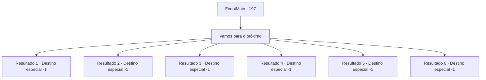

# Eventos principais · 197

[Índice da tabela](index.md) · [Índice geral](../index.md)

ID: `pt:EventMain:197` · Fonte: `EventMain4` · Versão: 1.2.47.

Mapeamento estático dos arquivos; a disponibilidade e a execução dependem do estado da run.

## Texto do evento

Você viaja pela cidade com Halad, fazendo-a pedir desculpas às pessoas que ela encantou,  e as famílias dos encantados que pensavam que estavam mortos.  É um processo doloroso. Halad não entende por que ela precisa se desculpar,  e a maioria das pessoas não é muito receptiva ao seu pedido de desculpas. Alguns até jogam pedras nela.  Esta parte da cidade que você está passando agora não é diferente.  Você a leva para fora da área depois que ela recebe muitos insultos.

## Dados de entrada

```json
{
  "id": 197,
  "grade": 1,
  "normalGoal": "",
  "required": "13_1_26|1_2_100"
}
```

## Mapa das escolhas



## Escolhas e resultados

### Escolha 1

Vamos para o próximo

Requisitos e outros campos da escolha:

```json
{
  "required": ""
}
```

#### Resultado 1.1

Você leva Halad para a próxima cidade. Ela fica um pouco amuada, mas não reclama muito. Vocês dois caminham juntos em silêncio.

Continuação registrada: [Destino especial `-1`](../destinos-especiais.md).

```json
{
  "required": "18_77_2|18_77_3",
  "chance": "1",
  "nextEvent": -1,
  "type": 2,
  "reward": "15_2_18"
}
```

#### Resultado 1.2

Você leva Halad para a próxima cidade. Ela fica um pouco amuada, mas não reclama muito. Vocês dois caminham juntos em silêncio.

Continuação registrada: [Destino especial `-1`](../destinos-especiais.md).

```json
{
  "required": "5_77_2",
  "chance": "1",
  "nextEvent": -1,
  "type": 2,
  "reward": "15_2_4|15_2_18"
}
```

#### Resultado 1.3

Você leva Halad para a próxima cidade. Ela fica um pouco amuada, mas não reclama muito. Vocês dois caminham juntos em silêncio.

Continuação registrada: [Destino especial `-1`](../destinos-especiais.md).

```json
{
  "required": "5_77_3",
  "chance": "1",
  "nextEvent": -1,
  "type": 2,
  "reward": "15_2_18|15_2_5"
}
```

#### Resultado 1.4

Você leva Halad para a próxima cidade. Ela fica um pouco amuada, mas não reclama muito. Vocês dois caminham juntos em silêncio.

Continuação registrada: [Destino especial `-1`](../destinos-especiais.md).

```json
{
  "required": "13_1_13|18_79_1|18_77_2|18_77_3",
  "chance": "1",
  "nextEvent": -1,
  "type": 2,
  "reward": "15_2_18"
}
```

#### Resultado 1.5

Você leva Halad para a próxima cidade. Ela fica um pouco amuada, mas não reclama muito. Vocês dois caminham juntos em silêncio.

Continuação registrada: [Destino especial `-1`](../destinos-especiais.md).

```json
{
  "required": "13_1_12|18_79_1|18_77_2|18_77_3",
  "chance": "1",
  "nextEvent": -1,
  "type": 2,
  "reward": "15_2_18|15_2_20"
}
```

#### Resultado 1.6

Você leva Halad para a próxima cidade. Ela fica um pouco amuada, mas não reclama muito. Vocês dois caminham juntos em silêncio.

Continuação registrada: [Destino especial `-1`](../destinos-especiais.md).

```json
{
  "required": "13_1_11|18_79_1|18_77_2|18_77_3",
  "chance": "1",
  "nextEvent": -1,
  "type": 2,
  "reward": "15_2_18"
}
```

## Referências que chegam a este evento

Nenhum `nextEvent` positivo da mesma tabela aponta para este nó. Isso não prova que seja inacessível: sorteio e estado de história podem selecioná-lo.

