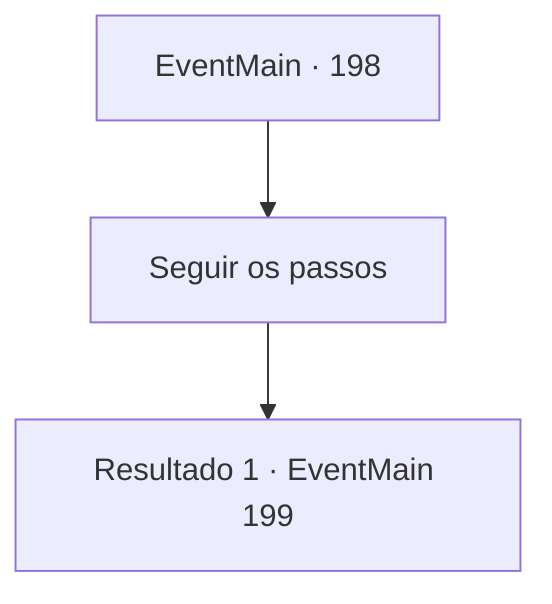

# Eventos principais · 198

[Índice da tabela](index.md) · [Índice geral](../index.md)

ID: `pt:EventMain:198` · Fonte: `EventMain4` · Versão: 1.2.47.

Mapeamento estático dos arquivos; a disponibilidade e a execução dependem do estado da run.

## Texto do evento

Você chega à pequena cidade de Perdant.  Ela está localizada no sopé da Montanha de Oito Círculos,  formado principalmente por lenhadores e caçadores.  Nem uma única alma pode ser vista.  Você se lembra do que aconteceu em Wagonmountain,  onde toda a população foi raptada.

## Dados de entrada

```json
{
  "id": 198,
  "grade": 1,
  "normalGoal": "",
  "required": "13_1_21|1_2_100"
}
```

## Mapa das escolhas



## Escolhas e resultados

### Escolha 1

Seguir os passos

Requisitos e outros campos da escolha:

```json
{
  "required": ""
}
```

#### Resultado 1.1

Você segue os passos de uma montanha. Está estranhamente quieto. Depois de uma longa caminhada, vocês dois chegam em frente a um gigantesco muro de pedra. Os passos param ali, como se passassem por ali. Edmond pega um pequeno botão prateado e acena com a mão. A parede derrete como aquarela, revelando uma caverna. É muito estreito e escuro perto da abertura para entrar sem o equipamento adequado.

Continuação registrada: [Evento 199](0199.md) na mesma tabela.

```json
{
  "required": "",
  "chance": "1",
  "nextEvent": 199,
  "type": 2,
  "reward": ""
}
```

## Referências que chegam a este evento

Nenhum `nextEvent` positivo da mesma tabela aponta para este nó. Isso não prova que seja inacessível: sorteio e estado de história podem selecioná-lo.

