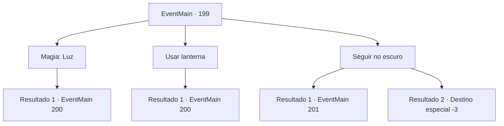

# Eventos principais · 199

[Índice da tabela](index.md) · [Índice geral](../index.md)

ID: `pt:EventMain:199` · Fonte: `EventMain4` · Versão: 1.2.47.

Mapeamento estático dos arquivos; a disponibilidade e a execução dependem do estado da run.

## Texto do evento

*Sem texto no arquivo.*

## Dados de entrada

```json
{
  "id": 199,
  "grade": 1,
  "normalGoal": "",
  "required": ""
}
```

## Mapa das escolhas



## Escolhas e resultados

### Escolha 1

Magia: Luz

Requisitos e outros campos da escolha:

```json
{
  "required": "20_0_1"
}
```

#### Resultado 1.1

Você produz um pequeno globo de luz da ponta de sua varinha. À medida que você viaja mais para dentro, você ouve as vozes das pessoas sussurrando à distância. Você chega a uma grande abertura encontrar-se em um mar de pessoas orando. |drawing_prayerInCave| Alguns fanáticos com tochas os cercam.

Continuação registrada: [Evento 200](0200.md) na mesma tabela.

```json
{
  "required": "",
  "chance": "1",
  "nextEvent": 200,
  "type": 2,
  "reward": ""
}
```

### Escolha 2

Usar lanterna

Requisitos e outros campos da escolha:

```json
{
  "required": "8_42_1"
}
```

#### Resultado 2.1

Você pega uma lanterna e acende. À medida que você viaja mais para dentro, você ouve as vozes das pessoas sussurrando à distância. Você chega a uma grande abertura encontrar-se em um mar de pessoas orando. |drawing_prayerInCave| Alguns fanáticos com tochas os cercam.

Continuação registrada: [Evento 200](0200.md) na mesma tabela.

```json
{
  "required": "",
  "chance": "1",
  "nextEvent": 200,
  "type": 2,
  "reward": ""
}
```

### Escolha 3

Seguir no escuro

Requisitos e outros campos da escolha:

```json
{
  "required": ""
}
```

#### Resultado 3.1

Você entra na caverna escura. Logo depois, você escorrega e cai no chão. Você cai na caverna em uma abertura e olha para cima. Os fanáticos de Halad estão olhando para você.

Continuação registrada: [Evento 201](0201.md) na mesma tabela.

```json
{
  "required": "1_0_2",
  "chance": "1",
  "nextEvent": 201,
  "type": 2,
  "reward": "6_3_71|0_0_-1",
  "place": 6
}
```

#### Resultado 3.2

Você entra na caverna escura. Logo depois, você escorrega e cai no chão. Você cai na caverna. Essa é a última coisa que você lembra.

Continuação registrada: [Destino especial `-3`](../destinos-especiais.md).

```json
{
  "required": "2_0_2",
  "chance": "1",
  "nextEvent": -3,
  "type": 2,
  "reward": "0_0_-1"
}
```

## Referências que chegam a este evento

- [Evento 198 · escolha 1 · resultado 1](0198.md#escolha-1)
