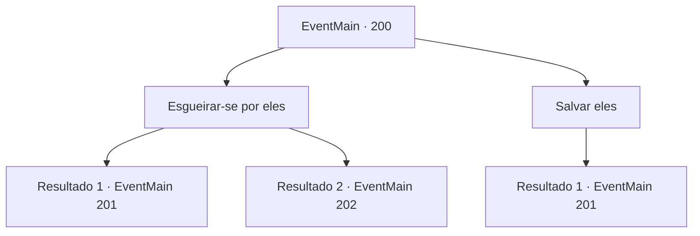

# Eventos principais · 200

[Índice da tabela](index.md) · [Índice geral](../index.md)

ID: `pt:EventMain:200` · Fonte: `EventMain4` · Versão: 1.2.47.

Mapeamento estático dos arquivos; a disponibilidade e a execução dependem do estado da run.

## Texto do evento

*Sem texto no arquivo.*

## Dados de entrada

```json
{
  "id": 200,
  "grade": 1,
  "normalGoal": "",
  "required": ""
}
```

## Mapa das escolhas



## Escolhas e resultados

### Escolha 1

Esgueirar-se por eles

Requisitos e outros campos da escolha:

```json
{
  "required": ""
}
```

#### Resultado 1.1

Você decide que seria um desperdício fazer uma cena. Você tenta se mover com cuidado, concentrando-se em cada passo. Mas o chão está escorregadio e você cai de bunda. Os fanáticos se voltam e olham para você quase imediatamente. 

 "Quem é Você!"


Continuação registrada: [Evento 201](0201.md) na mesma tabela.

```json
{
  "required": "",
  "chance": "10",
  "nextEvent": 201,
  "type": 2,
  "reward": "6_0_71",
  "place": 6
}
```

#### Resultado 1.2

Você decide que seria um desperdício fazer uma cena. Você se move com cuidado e silêncio, para longe dos fanáticos e para dentro da caverna. A caverna se torna maior à medida que você viaja para dentro, e o fedor piora a cada passo. Então você sente algo à frente. Você aperta os olhos e vê algo colossal parado no escuro.

Continuação registrada: [Evento 202](0202.md) na mesma tabela.

```json
{
  "required": "",
  "chance": "1|0_6_1",
  "nextEvent": 202,
  "type": 2,
  "reward": ""
}
```

### Escolha 2

Salvar eles

Requisitos e outros campos da escolha:

```json
{
  "required": "1_3_0"
}
```

#### Resultado 2.1

Você saca sua arma e ataca os fanáticos. Assustados, eles chamam os outros. 

 "Intrusos!!"


Continuação registrada: [Evento 201](0201.md) na mesma tabela.

```json
{
  "required": "",
  "chance": "1",
  "nextEvent": 201,
  "type": 2,
  "reward": "6_3_71",
  "place": 6
}
```

## Referências que chegam a este evento

- [Evento 199 · escolha 1 · resultado 1](0199.md#escolha-1)
- [Evento 199 · escolha 2 · resultado 1](0199.md#escolha-2)
