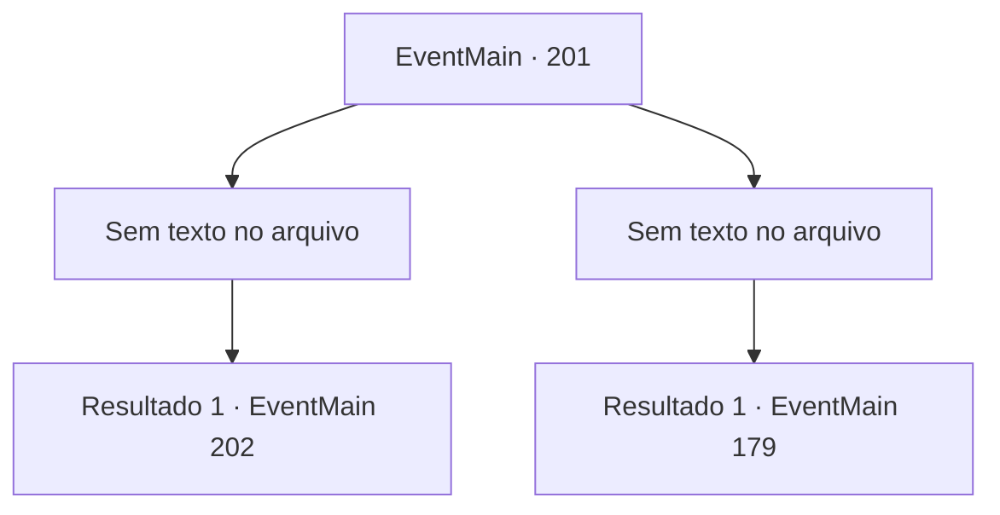

# Eventos principais · 201

[Índice da tabela](index.md) · [Índice geral](../index.md)

ID: `pt:EventMain:201` · Fonte: `EventMain4` · Versão: 1.2.47.

Mapeamento estático dos arquivos; a disponibilidade e a execução dependem do estado da run.

## Texto do evento

*Sem texto no arquivo.*

## Dados de entrada

```json
{
  "id": 201,
  "grade": 1,
  "normalGoal": "",
  "required": ""
}
```

## Mapa das escolhas



## Escolhas e resultados

### Escolha 1

*Sem texto no arquivo; o papel dessa opção depende da interface do jogo.*

Requisitos e outros campos da escolha:

```json
{
  "required": ""
}
```

#### Resultado 1.1

Você derruba os fanáticos. Mas as pessoas ficam encantadas. Você decide viajar mais fundo na caverna. Torna-se maior à medida que você viaja para dentro, e um fedor piora a cada passo. Então você sente algo à frente. Você aperta os olhos e vê algo colossal parado no escuro.

Continuação registrada: [Evento 202](0202.md) na mesma tabela.

```json
{
  "required": "",
  "chance": "1",
  "nextEvent": 202,
  "type": 2,
  "reward": "5_93_1"
}
```

### Escolha 2

*Sem texto no arquivo; o papel dessa opção depende da interface do jogo.*

Requisitos e outros campos da escolha:

```json
{
  "required": ""
}
```

#### Resultado 2.1

Você derruba os Zelotes. Ao amarrá-los com uma corda, um portal se abre e Edmond emerge dele. Sua varinha dispara raios nos fanáticos, derrubando-os para sempre. 

 "Ótimo trabalho. Encontrei meu caminho até aqui graças a você. Esse botão tem uma função de rastreamento, você vê."

 Edmond começa a desencantar a multidão que ora. 

 "Vou ajudar essas pessoas a se recuperarem, vá em frente."

 Você o deixa com isso e continua mais na caverna. A caverna se torna maior à medida que você viaja para dentro, e o fedor piora a cada passo. Então você sente algo à frente. Você aperta os olhos e vê algo colossal parado no escuro.

Continuação registrada: [Evento 179](0179.md) na mesma tabela.

```json
{
  "required": "",
  "chance": "1",
  "nextEvent": 179,
  "type": 2,
  "reward": "5_85_1"
}
```

## Referências que chegam a este evento

- [Evento 199 · escolha 3 · resultado 1](0199.md#escolha-3)
- [Evento 200 · escolha 1 · resultado 1](0200.md#escolha-1)
- [Evento 200 · escolha 2 · resultado 1](0200.md#escolha-2)
