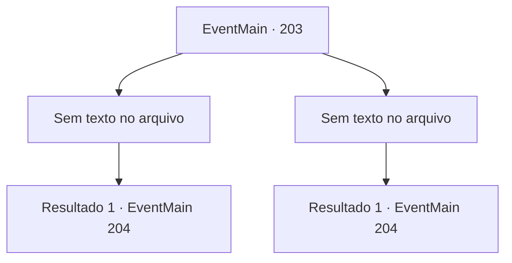

# Eventos principais · 203

[Índice da tabela](index.md) · [Índice geral](../index.md)

ID: `pt:EventMain:203` · Fonte: `EventMain4` · Versão: 1.2.47.

Mapeamento estático dos arquivos; a disponibilidade e a execução dependem do estado da run.

## Texto do evento

*Sem texto no arquivo.*

## Dados de entrada

```json
{
  "id": 203,
  "grade": 1,
  "normalGoal": "",
  "required": ""
}
```

## Mapa das escolhas



## Escolhas e resultados

### Escolha 1

*Sem texto no arquivo; o papel dessa opção depende da interface do jogo.*

Requisitos e outros campos da escolha:

```json
{
  "required": ""
}
```

#### Resultado 1.1

Você nocauteia o fanático. Edmond alcança logo depois. Ele está sem fôlego. 

 "Ah! Ainda bem que não demorei. Demorei um pouco para evacuar todas aquelas pessoas."


Continuação registrada: [Evento 204](0204.md) na mesma tabela.

```json
{
  "required": "",
  "chance": "1",
  "nextEvent": 204,
  "type": 2,
  "reward": ""
}
```

### Escolha 2

*Sem texto no arquivo; o papel dessa opção depende da interface do jogo.*

Requisitos e outros campos da escolha:

```json
{
  "required": ""
}
```

#### Resultado 2.1

Você está lutando contra o fanático quando Edmond entra na caverna. Ele está sem fôlego. 

 "Ah! Ainda bem que não demorei. Demorei um pouco para evacuar todas aquelas pessoas."

 Ele rapidamente produz uma dúzia de flechas magias e explode o fanático.

Continuação registrada: [Evento 204](0204.md) na mesma tabela.

```json
{
  "required": "",
  "chance": "1",
  "nextEvent": 204,
  "type": 2,
  "reward": ""
}
```

## Referências que chegam a este evento

- [Evento 202 · escolha 1 · resultado 1](0202.md#escolha-1)
- [Evento 202 · escolha 1 · resultado 3](0202.md#escolha-1)
- [Evento 202 · escolha 1 · resultado 4](0202.md#escolha-1)
- [Evento 202 · escolha 2 · resultado 1](0202.md#escolha-2)
- [Evento 202 · escolha 2 · resultado 3](0202.md#escolha-2)
- [Evento 202 · escolha 2 · resultado 4](0202.md#escolha-2)
