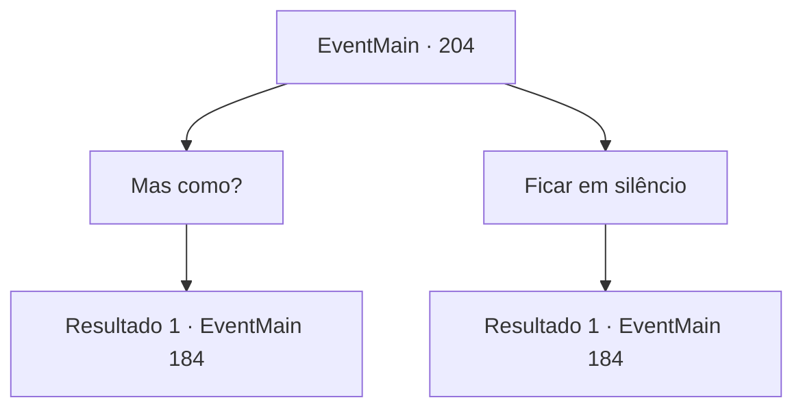

# Eventos principais · 204

[Índice da tabela](index.md) · [Índice geral](../index.md)

ID: `pt:EventMain:204` · Fonte: `EventMain4` · Versão: 1.2.47.

Mapeamento estático dos arquivos; a disponibilidade e a execução dependem do estado da run.

## Texto do evento

*Sem texto no arquivo.*

## Dados de entrada

```json
{
  "id": 204,
  "grade": 1,
  "normalGoal": "",
  "required": ""
}
```

## Mapa das escolhas



## Escolhas e resultados

### Escolha 1

Mas como?

Requisitos e outros campos da escolha:

```json
{
  "required": ""
}
```

#### Resultado 1.1

Você e Halad perguntam ao mesmo tempo. Edmond solta uma risada. 

 "Hah... dois dos meus alunos fazendo a mesma pergunta. Eu te dei um rastreador, o botão. Mas eu discordo. Temos assuntos mais importantes em mãos."

 Halad imediatamente se teletransporta para o topo do colosso de carne. Então ela se torna um com ele. Seu grito perfura seus ouvidos. 

 "Eu não queria fazer isso, mas vou ter que esmagar vocês dois!!"

 O colosso fica de pé, ventos de fedor entorpecente soprando em todas as direções. Edmond explica a você sobre a fera por trás. 

 "Um colosso é imune à maioria das magias. Você precisa distraí-lo para mim enquanto eu preparo um longo feitiço."


Continuação registrada: [Evento 184](0184.md) na mesma tabela.

```json
{
  "required": "",
  "chance": "1",
  "nextEvent": 184,
  "type": 2,
  "reward": "6_0_83",
  "place": 6
}
```

### Escolha 2

Ficar em silêncio

Requisitos e outros campos da escolha:

```json
{
  "required": ""
}
```

#### Resultado 2.1

Você decide não dizer nada. Halad pergunta a Edmond como ele encontrou a caverna. 

 "Nada disso importa. O que importa é que estou aqui para impedi-lo."

 Halad imediatamente se teletransporta para o topo do colosso de carne. Então ela se torna um com ele. Seu grito perfura seus ouvidos. 

 "Eu não queria fazer isso, mas vou ter que esmagar vocês dois!!"

 O colosso fica de pé, ventos de fedor entorpecente soprando em todas as direções. Edmond explica a você sobre a fera por trás. 

 "Um colosso é imune à maioria das magias. Você precisa distraí-lo para mim enquanto eu preparo um longo feitiço."


Continuação registrada: [Evento 184](0184.md) na mesma tabela.

```json
{
  "required": "",
  "chance": "1",
  "nextEvent": 184,
  "type": 2,
  "reward": "6_0_83",
  "place": 6
}
```

## Referências que chegam a este evento

- [Evento 203 · escolha 1 · resultado 1](0203.md#escolha-1)
- [Evento 203 · escolha 2 · resultado 1](0203.md#escolha-2)
