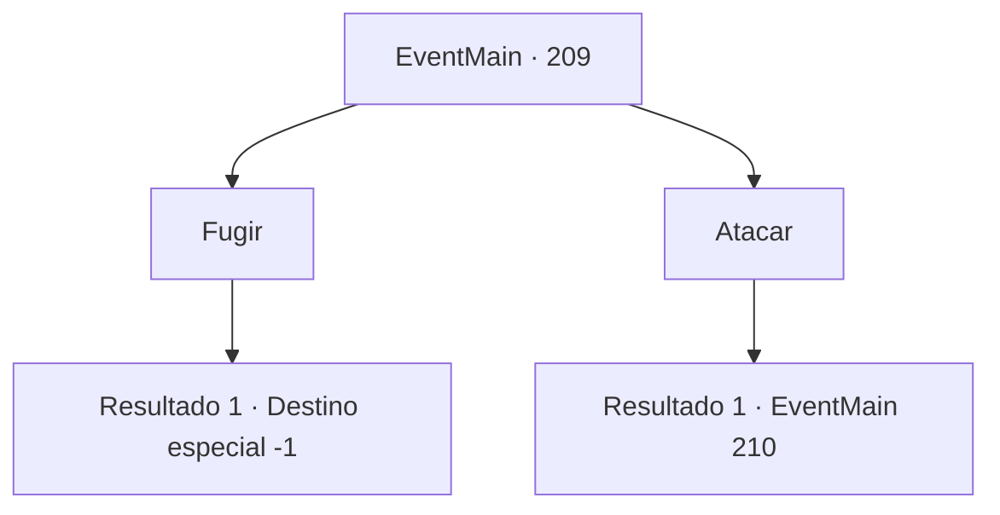

# Eventos principais · 209

[Índice da tabela](index.md) · [Índice geral](../index.md)

ID: `pt:EventMain:209` · Fonte: `EventMain4` · Versão: 1.2.47.

Mapeamento estático dos arquivos; a disponibilidade e a execução dependem do estado da run.

## Texto do evento

Na praça de uma cidade, você consegue um jornal, entregue por um garotinho.
 <As Montanhas Atilante são uma Barricada Intransponível>
 Na notícia está escrito que o Reino perdeu sua guerra contra os elfos, e concordou em não atravessar as Montanhas Atilante do Norte. Além disso, há artigos especulativos aludindo à punição inevitável que recairá sobre os respectivos oficiais, que serão responsabilizados pela derrota. Ao entregar o jornal de volta ao entregador, você percebe um homem sendo capturado por guardas armados. 

 "Deixe-me ir! Por que você está fazendo isso!"

 O homem capturado pergunta o motivo de sua prisão, lutando. O guarda responde, perplexo. 

 "Você não respondeu ao decreto de recrutamento, que obviamente deveria ter. Isso é motivo suficiente para prendê-lo."


## Dados de entrada

```json
{
  "id": 209,
  "grade": 1,
  "normalGoal": "",
  "required": "13_0_27|1_2_100"
}
```

## Mapa das escolhas



## Escolhas e resultados

### Escolha 1

Fugir

Requisitos e outros campos da escolha:

```json
{
  "required": ""
}
```

#### Resultado 1.1

Você rapidamente se esconde no beco da rua. Você sente que eles estarão atrás de você em breve. Você chega à conclusão de que não poderá mais ficar aqui e começar seus passos, com a decisão de se mudar para outro país.

Continuação registrada: [Destino especial `-1`](../destinos-especiais.md).

```json
{
  "required": "",
  "chance": "1",
  "nextEvent": -1,
  "type": 2,
  "reward": "15_0_9"
}
```

### Escolha 2

Atacar

Requisitos e outros campos da escolha:

```json
{
  "required": ""
}
```

#### Resultado 2.1

Você saca sua arma e ataca os guardas. <link=shake>

 "O que... o que!"

</link> Um guarda cai no chão da emboscada e o outro puxa sua espada.

Continuação registrada: [Evento 210](0210.md) na mesma tabela.

```json
{
  "required": "",
  "chance": "1",
  "nextEvent": 210,
  "type": 2,
  "reward": "6_0_21|0_3_-1",
  "place": 6
}
```

## Referências que chegam a este evento

Nenhum `nextEvent` positivo da mesma tabela aponta para este nó. Isso não prova que seja inacessível: sorteio e estado de história podem selecioná-lo.

