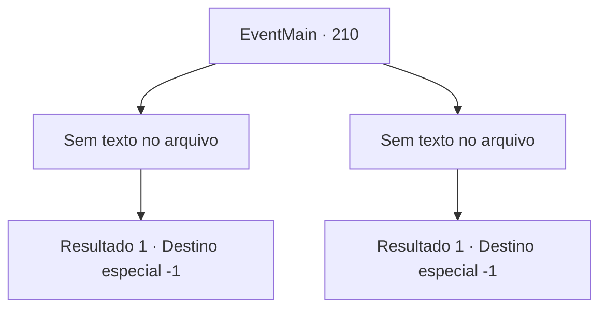

# Eventos principais · 210

[Índice da tabela](index.md) · [Índice geral](../index.md)

ID: `pt:EventMain:210` · Fonte: `EventMain4` · Versão: 1.2.47.

Mapeamento estático dos arquivos; a disponibilidade e a execução dependem do estado da run.

## Texto do evento

*Sem texto no arquivo.*

## Dados de entrada

```json
{
  "id": 210,
  "grade": 1,
  "normalGoal": "",
  "required": ""
}
```

## Mapa das escolhas



## Escolhas e resultados

### Escolha 1

*Sem texto no arquivo; o papel dessa opção depende da interface do jogo.*

Requisitos e outros campos da escolha:

```json
{
  "required": ""
}
```

#### Resultado 1.1

Os dois guardas caem de seus ataques. 

 "Eu... eu não tenho ideia de quem você é, mas obrigado! Haverá mais guardas aqui em breve, então você deve correr também."

 O homem capturado lhe entrega algumas moedas de ouro e foge às pressas. Você olha para os guardas nocauteados no chão e pensa que os reforços estarão atrás de você. Você chega à conclusão de que não poderá mais ficar aqui e comece seus passos, decidindo se mudar para outro país.

Continuação registrada: [Destino especial `-1`](../destinos-especiais.md).

```json
{
  "required": "",
  "chance": "1",
  "nextEvent": -1,
  "type": 2,
  "reward": "0_4_10|15_0_9"
}
```

### Escolha 2

*Sem texto no arquivo; o papel dessa opção depende da interface do jogo.*

Requisitos e outros campos da escolha:

```json
{
  "required": ""
}
```

#### Resultado 2.1

Você é espancado pelos guardas e preso no local. O guarda diz enquanto te amarra com uma corda. 

 "Você com certeza sabe como deixar um homem cansado. Eu não sei qual é a sua relação com aquele cara, mas vou gentilmente lhe mostrar por que não se mexe com os guardas. Você pode esperar por isso."

 Ele te joga na cela fria da prisão.

Continuação registrada: [Destino especial `-1`](../destinos-especiais.md).

```json
{
  "required": "",
  "chance": "1",
  "nextEvent": -1,
  "type": 2,
  "reward": "15_1_14|15_1_1"
}
```

## Referências que chegam a este evento

- [Evento 209 · escolha 2 · resultado 1](0209.md#escolha-2)
