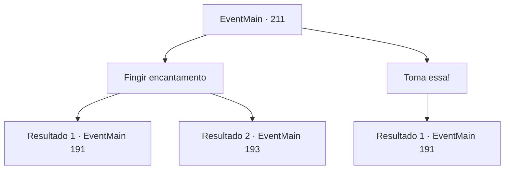

# Eventos principais · 211

[Índice da tabela](index.md) · [Índice geral](../index.md)

ID: `pt:EventMain:211` · Fonte: `EventMain4` · Versão: 1.2.47.

Mapeamento estático dos arquivos; a disponibilidade e a execução dependem do estado da run.

## Texto do evento

*Sem texto no arquivo.*

## Dados de entrada

```json
{
  "id": 211,
  "grade": 1,
  "normalGoal": "",
  "required": ""
}
```

## Mapa das escolhas



## Escolhas e resultados

### Escolha 1

Fingir encantamento

Requisitos e outros campos da escolha:

```json
{
  "required": ""
}
```

#### Resultado 1.1

Você faz o que Halad diz, revelando lentamente sua barriga, deitada no chão. Infelizmente, ela percebe sua atuação estranha. 

 "Você... como você não é afetado pelo meu feitiço?"

 Ela aponta sua equipe para você, com um olhar seriamente irritado no rosto. 

 "Eu vou matar você...!"


Continuação registrada: [Evento 191](0191.md) na mesma tabela.

```json
{
  "required": "",
  "chance": "10",
  "nextEvent": 191,
  "type": 1,
  "reward": "6_0_79",
  "place": 6
}
```

#### Resultado 1.2

Você faz o que Halad diz, revelando lentamente sua barriga, deitada no chão. Ela sorri com satisfação, enrolando o canto da boca. Nesse momento, Edmond entra na caverna. 

 "O que você está fazendo...?"

 Halad a cumprimenta, como se ela estivesse feliz em vê-lo. 

 "Ah, presidente. Seu aprendiz é meu agora."

 Então ela ordena que você mate Edmond. Halad está de pé com as costas totalmente expostas a você.

Continuação registrada: [Evento 193](0193.md) na mesma tabela.

```json
{
  "required": "",
  "chance": "1|0_12_1",
  "nextEvent": 193,
  "type": 0,
  "reward": ""
}
```

### Escolha 2

Toma essa!

Requisitos e outros campos da escolha:

```json
{
  "required": ""
}
```

#### Resultado 2.1

Você soca Halad imediatamente. Sua habilidade física era patética, caindo de costas com um soco. 

 "H... Halad!"

 Seu seguidor fica atônito, ao puxá-la para trás. 

 "Urk... seu bastardo... eu vou te matar!"

 Halad olha para você, limpando o sangue de seu lábio quebrado. Então ela puxa seu cajado.

Continuação registrada: [Evento 191](0191.md) na mesma tabela.

```json
{
  "required": "",
  "chance": "1",
  "nextEvent": 191,
  "type": 2,
  "reward": "6_2_79",
  "place": 6
}
```

## Referências que chegam a este evento

- [Evento 182 · escolha 2 · resultado 6](0182.md#escolha-2)
