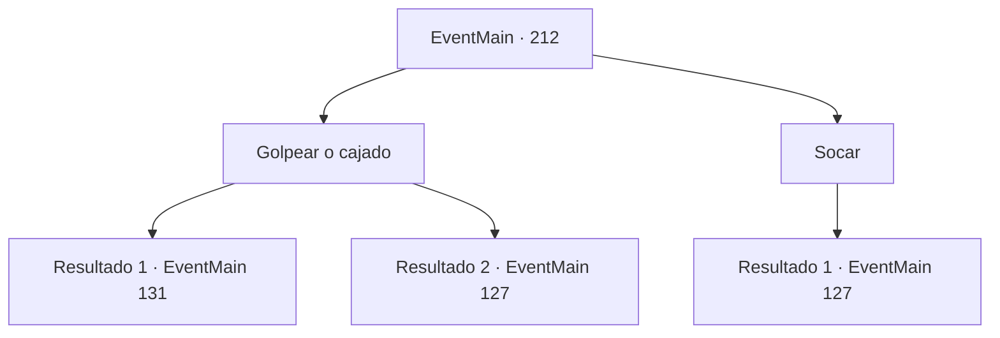

# Eventos principais · 212

[Índice da tabela](index.md) · [Índice geral](../index.md)

ID: `pt:EventMain:212` · Fonte: `EventMain4` · Versão: 1.2.47.

Mapeamento estático dos arquivos; a disponibilidade e a execução dependem do estado da run.

## Texto do evento

*Sem texto no arquivo.*

## Dados de entrada

```json
{
  "id": 212,
  "grade": 1,
  "normalGoal": "",
  "required": ""
}
```

## Mapa das escolhas



## Escolhas e resultados

### Escolha 1

Golpear o cajado

Requisitos e outros campos da escolha:

```json
{
  "required": ""
}
```

#### Resultado 1.1

Você bate no cajado apontado para sua testa. O cajado de Halad escapa de sua mão e voa para o canto da sala. Ela grita, espantada. 

 "Você... você... como? Droga... Edmond!"

 Halad chama o presidente, com voz irritada. Então, uma túnica caída no chão de repente forma a silhueta de um humano. |drawing_wormThatWalk| Mas, não é o presidente que você conhecia, e onde o rosto deveria estar, é um enxame de insetos trêmulos. Halad comanda o enxame em movimento para matá-lo. No entanto, o enxame balança a cabeça, dizendo que não. 

 "Eu não desejo lutar contra meu próprio aprendiz. E você... você nem quer dizer isso."

 O enxame passa lentamente por você e vasculha os livros nas prateleiras. Quando você começa a entender o que diabos está fazendo, a prateleira se move e revela uma sala escondida.

Continuação registrada: [Evento 131](0131.md) na mesma tabela.

```json
{
  "required": "5_68_4",
  "chance": "1",
  "nextEvent": 131,
  "type": 2,
  "reward": ""
}
```

#### Resultado 1.2

Você bate no cajado apontado para sua testa. O cajado de Halad escapa de sua mão e voa para o canto da sala. Ela grita, espantada. 

 "Você... você... como? Droga... Edmond!"

 Halad chama o presidente, com voz irritada. Então, uma túnica caída no chão de repente forma a silhueta de um humano. |drawing_wormThatWalk| Mas, não é o presidente que você conhecia, e onde o rosto deveria estar, é um enxame de insetos trêmulos. Halad comanda o enxame em movimento para matá-lo. O enxame olha para você em silêncio.

Continuação registrada: [Evento 127](0127.md) na mesma tabela.

```json
{
  "required": "18_68_4",
  "chance": "1",
  "nextEvent": 127,
  "type": 2,
  "reward": ""
}
```

### Escolha 2

Socar

Requisitos e outros campos da escolha:

```json
{
  "required": ""
}
```

#### Resultado 2.1

Você soca Halad imediatamente. Sua habilidade física era patética, caindo de costas com um soco. Ela grita, espantada. 

 "Você... você... como? Droga... Edmond!"

 Halad chama o presidente, com voz irritada. Então, uma túnica caída no chão de repente forma a silhueta de um humano. |drawing_wormThatWalk| Mas, não é o presidente que você conhecia, e onde o rosto deveria estar, é um enxame de insetos trêmulos. Halad comanda o enxame em movimento para matá-lo. O enxame olha para você em silêncio.

Continuação registrada: [Evento 127](0127.md) na mesma tabela.

```json
{
  "required": "",
  "chance": "1",
  "nextEvent": 127,
  "type": 2,
  "reward": ""
}
```

## Referências que chegam a este evento

- [Evento 126 · escolha 2 · resultado 8](0126.md#escolha-2)
- [Evento 126 · escolha 2 · resultado 9](0126.md#escolha-2)
