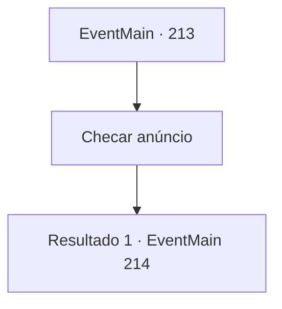

# Eventos principais · 213

[Índice da tabela](index.md) · [Índice geral](../index.md)

ID: `pt:EventMain:213` · Fonte: `EventMain4` · Versão: 1.2.47.

Mapeamento estático dos arquivos; a disponibilidade e a execução dependem do estado da run.

## Texto do evento

Você segue para, o que presume, ter sido a direção em que o dragão voou. Você chega em 'Alto Ferro', conhecido como o primeiro lugar que o Imperador de Zaipent conquistou, quando ele era apenas um Rei. É uma comunidade mineira, ostentando um grande depósito de ferro, e os ferreiros trabalham incansavelmente com ferro derretido. Na cidade agitada, é possível ver alguém afixar um anúncio na praça da cidade.

## Dados de entrada

```json
{
  "id": 213,
  "grade": 1,
  "normalGoal": "",
  "required": "13_2_0|1_2_0"
}
```

## Mapa das escolhas



## Escolhas e resultados

### Escolha 1

Checar anúncio

Requisitos e outros campos da escolha:

```json
{
  "required": ""
}
```

#### Resultado 1.1

O anúncio diz: 'Um dragão maligno sequestrou a princesa Esit, o tesouro do palácio real. Qualquer um que puder trazer de volta a princesa do dragão terá seus desejos atendidos.', com o selo do Imperador impresso. De repente, uma mão sai da multidão e agarra você. É uma velha bruxa com um pano ensanguentado cobrindo onde seus olhos deveriam estar. Ela inclina o rosto para perto de você, como se cheirasse alguma coisa.

Continuação registrada: [Evento 214](0214.md) na mesma tabela.

```json
{
  "required": "",
  "chance": "1",
  "nextEvent": 214,
  "type": 2,
  "reward": ""
}
```

## Referências que chegam a este evento

Nenhum `nextEvent` positivo da mesma tabela aponta para este nó. Isso não prova que seja inacessível: sorteio e estado de história podem selecioná-lo.

