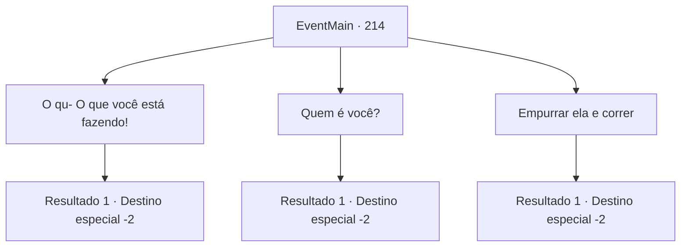

# Eventos principais · 214

[Índice da tabela](index.md) · [Índice geral](../index.md)

ID: `pt:EventMain:214` · Fonte: `EventMain4` · Versão: 1.2.47.

Mapeamento estático dos arquivos; a disponibilidade e a execução dependem do estado da run.

## Texto do evento

*Sem texto no arquivo.*

## Dados de entrada

```json
{
  "id": 214,
  "grade": 1,
  "normalGoal": "",
  "required": ""
}
```

## Mapa das escolhas



## Escolhas e resultados

### Escolha 1

O qu- O que você está fazendo!

Requisitos e outros campos da escolha:

```json
{
  "required": ""
}
```

#### Resultado 1.1

Ela fala calmamente com você, que agora está espantado, como se nada tivesse acontecido. 

 "Você terá que mergulhar a porta na água."

 Você quer perguntar mais sobre o que ela está falando, mas sua figura desaparece na multidão depois de terminar.

Continuação registrada: [Destino especial `-2`](../destinos-especiais.md).

```json
{
  "required": "",
  "chance": "1",
  "nextEvent": -2,
  "type": 2,
  "reward": "13_2_1|5_231_1"
}
```

### Escolha 2

Quem é você?

Requisitos e outros campos da escolha:

```json
{
  "required": ""
}
```

#### Resultado 2.1

Ela puxa o rosto para trás, então responde sua pergunta. 

 "Eu... fiz uma profecia para o Imperador que 'Sabedoria será a queda do Imperador.' Ele arrancou meus olhos, dizendo que eu estava falando bobagem."

  Depois de limpar a garganta, a bruxa continua em voz baixa. 

 "Eu vou te dar um conselho. Você terá que mergulhar a porta na água."

 Com isso a bruxa desaparece na multidão.

Continuação registrada: [Destino especial `-2`](../destinos-especiais.md).

```json
{
  "required": "",
  "chance": "1",
  "nextEvent": -2,
  "type": 2,
  "reward": "13_2_1|0_3_2|5_231_1"
}
```

### Escolha 3

Empurrar ela e correr

Requisitos e outros campos da escolha:

```json
{
  "required": ""
}
```

#### Resultado 3.1

Você empurra a bruxa para longe e foge. Ela gritou algo nas suas costas, mas você não ouviu.

Continuação registrada: [Destino especial `-2`](../destinos-especiais.md).

```json
{
  "required": "",
  "chance": "1",
  "nextEvent": -2,
  "type": 2,
  "reward": "13_2_1|0_3_-2"
}
```

## Referências que chegam a este evento

- [Evento 213 · escolha 1 · resultado 1](0213.md#escolha-1)
