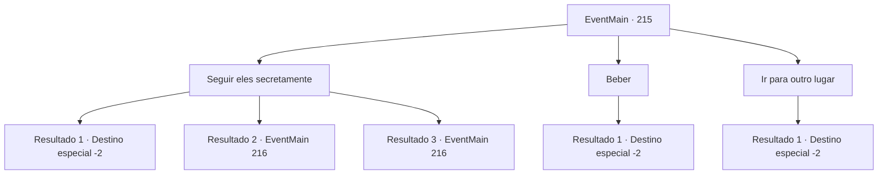

# Eventos principais · 215

[Índice da tabela](index.md) · [Índice geral](../index.md)

ID: `pt:EventMain:215` · Fonte: `EventMain4` · Versão: 1.2.47.

Mapeamento estático dos arquivos; a disponibilidade e a execução dependem do estado da run.

## Texto do evento

 'Fruki', a cidade que emerge no seu caminho.. Na taberna da cidade, você ouve por cima um par de habitantes comentar sobre um dragão. Um deles tem braços musculosos, acompanhado de um corpo volumoso,  e o outra é careca, mas tem uma barba, no mínimo, selvagem. 

 "Perguntar sobre a princesa e o dragão."

 O careca responde, 'Aye! Vi sim.', e bebe um gole de cerveja. Enquanto você ouve por cima as informações mais importantes, um cavaleiro com armadura extravagante coloca uma bolsa do que parecem ser moedas de ouro no balcão, Os três trocam algumas palavras e se levantam.

## Dados de entrada

```json
{
  "id": 215,
  "grade": 1,
  "normalGoal": "",
  "required": "13_2_1|1_2_20"
}
```

## Mapa das escolhas



## Escolhas e resultados

### Escolha 1

Seguir eles secretamente

Requisitos e outros campos da escolha:

```json
{
  "required": ""
}
```

#### Resultado 1.1

Você segue secretamente o cavaleiro estranho e os dois homens, mas você os perde de vista. Você procura ao seu redor sem sucesso e, eventualmente, vai para outro lugar.

Continuação registrada: [Destino especial `-2`](../destinos-especiais.md).

```json
{
  "required": "",
  "chance": "10",
  "nextEvent": -2,
  "type": 1,
  "reward": "13_2_3"
}
```

#### Resultado 1.2

Você segue secretamente o cavaleiro estranho e os dois homens. Eles entram em um beco, localizado nos arredores da cidade. No beco estava um homem vestido com roupas luxuosas, parecendo muito deslocado. |drawing_prince| O homem luxuoso se apresenta arrogantemente como 'Vertino, o príncipe de Arma'. Os dois da taverna exclamam surpresos. 

 "V..Vertino? O Matador de Dragões??"

 Ele ordena que seu cavaleiro pegue uma bolsa maior. Ele então abre a bolsa ligeiramente para revelar ouro nela. 

 "Fale tudo o que sabe sobre os rumores sobre o dragão que sequestrou a princesa."

 Os olhos dos dois homens brilham com ouro e revelam tudo o que sabem sobre o boato ao príncipe. Segundo eles, há uma porta que nunca se abre na montanha de 'Gar', parte das 'Montanhas Latnagar', e aparentemente aquela porta se abriu depois que o dragão cinza apareceu. O príncipe acena com a cabeça e gesticula seu cavaleiro com o queixo. O cavaleiro começa a decapitar as cabeças dos homens com sua espada sem hesitação.

Continuação registrada: [Evento 216](0216.md) na mesma tabela.

```json
{
  "required": "",
  "chance": "0_6_1",
  "nextEvent": 216,
  "type": 0,
  "reward": "5_135_1"
}
```

#### Resultado 1.3

Você segue secretamente o cavaleiro estranho e os dois homens. Eles entram em um beco, localizado nos arredores da cidade. No beco estava um homem vestido com roupas luxuosas, parecendo muito deslocado. |drawing_prince| O homem luxuoso se apresenta arrogantemente como 'Vertino, o príncipe de Arma'. Os dois da taverna exclamam surpresos. 

 "V..Vertino? O Matador de Dragões??"

 Ele ordena que seu cavaleiro pegue uma bolsa maior. Ele então abre a bolsa ligeiramente para revelar ouro nela. 

 "Fale tudo o que sabe sobre os rumores sobre o dragão que sequestrou a princesa."

 Os olhos dos dois homens brilham com ouro e revelam tudo o que sabem sobre o boato ao príncipe. Segundo eles, há uma porta que nunca se abre na montanha de 'Gar', parte das 'Montanhas Latnagar', e aparentemente aquela porta se abriu depois que o dragão cinza apareceu. O príncipe acena com a cabeça e gesticula seu cavaleiro com o queixo. O cavaleiro começa a decapitar as cabeças dos homens com sua espada sem hesitação.

Continuação registrada: [Evento 216](0216.md) na mesma tabela.

```json
{
  "required": "20_5_2",
  "chance": "0_6_1",
  "nextEvent": 216,
  "type": 0,
  "reward": "5_135_1"
}
```

### Escolha 2

Beber

Requisitos e outros campos da escolha:

```json
{
  "required": "1_4_5"
}
```

#### Resultado 2.1

Cuidando da sua vida, você liga para o dono da taverna e pede cerveja escura. Refresca sua mente. Depois de beber apenas o suficiente para se sentir feliz, você abaixa o copo e sai da taverna.

Continuação registrada: [Destino especial `-2`](../destinos-especiais.md).

```json
{
  "required": "",
  "chance": "1",
  "nextEvent": -2,
  "type": 2,
  "reward": "13_2_3|0_4_-5|0_1_1"
}
```

### Escolha 3

Ir para outro lugar

Requisitos e outros campos da escolha:

```json
{
  "required": ""
}
```

#### Resultado 3.1

Julgando que o bate-papo de alguns bêbados em uma taverna da cidade não vale a pena ouvir, você não os seguiu. Você também não está com vontade de beber, então sai da taverna.

Continuação registrada: [Destino especial `-2`](../destinos-especiais.md).

```json
{
  "required": "",
  "chance": "1",
  "nextEvent": -2,
  "type": 2,
  "reward": "13_2_3"
}
```

## Referências que chegam a este evento

Nenhum `nextEvent` positivo da mesma tabela aponta para este nó. Isso não prova que seja inacessível: sorteio e estado de história podem selecioná-lo.

