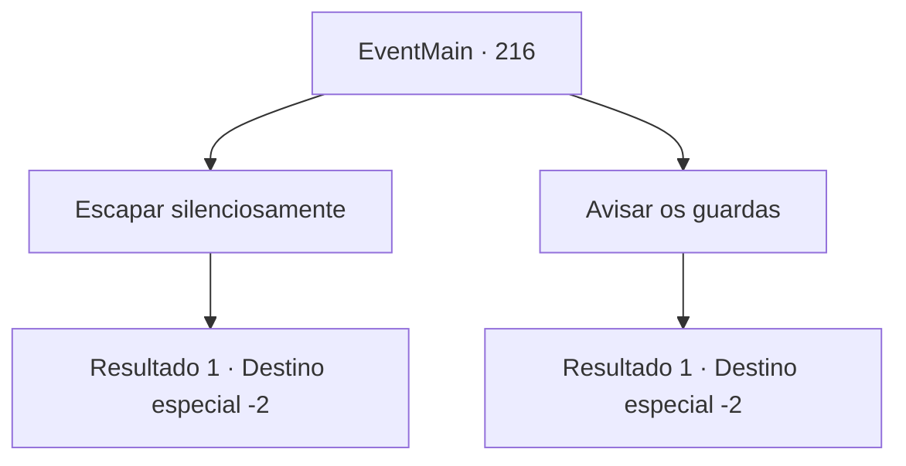

# Eventos principais · 216

[Índice da tabela](index.md) · [Índice geral](../index.md)

ID: `pt:EventMain:216` · Fonte: `EventMain4` · Versão: 1.2.47.

Mapeamento estático dos arquivos; a disponibilidade e a execução dependem do estado da run.

## Texto do evento

*Sem texto no arquivo.*

## Dados de entrada

```json
{
  "id": 216,
  "grade": 1,
  "normalGoal": "",
  "required": ""
}
```

## Mapa das escolhas



## Escolhas e resultados

### Escolha 1

Escapar silenciosamente

Requisitos e outros campos da escolha:

```json
{
  "required": ""
}
```

#### Resultado 1.1

O sangue molha o beco sombrio. A ruiva resmunga com uma voz irritada. 

 "O que eu esperava da ralé da rua... E se o dragão não tiver nada a ver com a porta...? Suspiro... acho que nossa única opção agora é ir até lá."

 Você respira fundo e anda para trás, com cuidado. Felizmente, eles não parecem notar sua presença. 

Continuação registrada: [Destino especial `-2`](../destinos-especiais.md).

```json
{
  "required": "",
  "chance": "1",
  "nextEvent": -2,
  "type": 2,
  "reward": "13_2_2"
}
```

### Escolha 2

Avisar os guardas

Requisitos e outros campos da escolha:

```json
{
  "required": ""
}
```

#### Resultado 2.1

O sangue molha o beco sombrio. Você procura o guarda da cidade patrulhando a cidade. Então você o notifica sobre o evento que aconteceu no beco. O guarda segue você pelas ruelas, mas os corpos não foram encontrados. Ele solta um suspiro profundo, conclui seu testemunho falso e vai embora.

Continuação registrada: [Destino especial `-2`](../destinos-especiais.md).

```json
{
  "required": "",
  "chance": "1",
  "nextEvent": -2,
  "type": 2,
  "reward": "13_2_2"
}
```

## Referências que chegam a este evento

- [Evento 215 · escolha 1 · resultado 2](0215.md#escolha-1)
- [Evento 215 · escolha 1 · resultado 3](0215.md#escolha-1)
