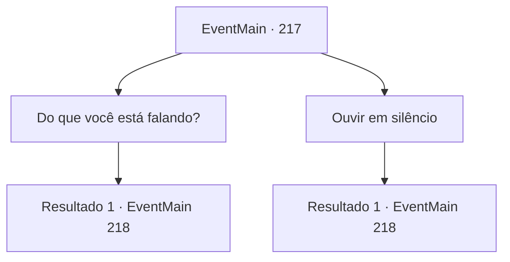

# Eventos principais · 217

[Índice da tabela](index.md) · [Índice geral](../index.md)

ID: `pt:EventMain:217` · Fonte: `EventMain4` · Versão: 1.2.47.

Mapeamento estático dos arquivos; a disponibilidade e a execução dependem do estado da run.

## Texto do evento

Você se dirige á montanha Gar, à procura da porta que só se abriu após o aparecimento do dragão. No caminho, encontra uma pequena aldeia chamada 'Terunai', da qual se pode ver as montanhas Latnagar no horizonte. A aldeia é habitada por pequenos grupos de cabritos, lenhadores e caçadores, e pode-se ver muitas diligências aristocráticas, E aventureiros. Um homem velho murmura algumas palavras, frases grandes o suficiente para você assumir que ele não está falando sozinho. 

 "Ugh... a ganância. Quantas vidas se perderão desta vez..."


## Dados de entrada

```json
{
  "id": 217,
  "grade": 1,
  "normalGoal": "",
  "required": "13_2_2|1_2_45"
}
```

## Mapa das escolhas



## Escolhas e resultados

### Escolha 1

Do que você está falando?

Requisitos e outros campos da escolha:

```json
{
  "required": ""
}
```

#### Resultado 1.1

Em resposta à sua pergunta, o velho lança um olhar para você, solta um suspiro profundo e continua. 

 "Você também está procurando o dragão de Gar, eu presumo? Os dragões não são as criaturas que os humanos podem ver sempre que quiserem. Embora eu não tenha ideia do que você faria depois de encontrar um... mas tome cuidado para não irritá-los e se matar."

 Depois de terminar, o velho exala a fumaça de um cachimbo.

Continuação registrada: [Evento 218](0218.md) na mesma tabela.

```json
{
  "required": "",
  "chance": "1",
  "nextEvent": 218,
  "type": 2,
  "reward": ""
}
```

### Escolha 2

Ouvir em silêncio

Requisitos e outros campos da escolha:

```json
{
  "required": ""
}
```

#### Resultado 2.1

Você ouve o velho em silêncio. Ele continua, sem se importar se você está ouvindo ou não. 

 "O que eles estão fazendo procurando por um dragão... Eles com certeza vão ficar nervosos e perder suas preciosas vidas..."

 Depois de terminar, o velho exala a fumaça de um cachimbo.

Continuação registrada: [Evento 218](0218.md) na mesma tabela.

```json
{
  "required": "",
  "chance": "1",
  "nextEvent": 218,
  "type": 2,
  "reward": ""
}
```

## Referências que chegam a este evento

Nenhum `nextEvent` positivo da mesma tabela aponta para este nó. Isso não prova que seja inacessível: sorteio e estado de história podem selecioná-lo.

