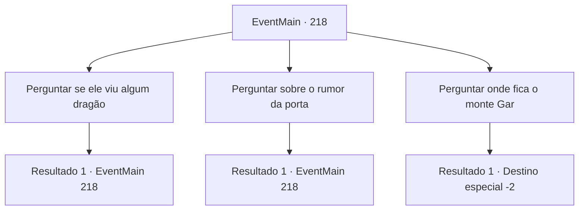

# Eventos principais · 218

[Índice da tabela](index.md) · [Índice geral](../index.md)

ID: `pt:EventMain:218` · Fonte: `EventMain4` · Versão: 1.2.47.

Mapeamento estático dos arquivos; a disponibilidade e a execução dependem do estado da run.

## Texto do evento

*Sem texto no arquivo.*

## Dados de entrada

```json
{
  "id": 218,
  "grade": 1,
  "normalGoal": "",
  "required": ""
}
```

## Mapa das escolhas



## Escolhas e resultados

### Escolha 1

Perguntar se ele viu algum dragão

Requisitos e outros campos da escolha:

```json
{
  "required": "5_133_0"
}
```

#### Resultado 1.1

O velho respondeu sua pergunta, olhando para a montanha distante. 

 "Não... eu nunca vi. Infelizmente."


Continuação registrada: [Evento 218](0218.md) na mesma tabela.

```json
{
  "required": "",
  "chance": "1",
  "nextEvent": 218,
  "type": 2,
  "reward": "5_133_1"
}
```

### Escolha 2

Perguntar sobre o rumor da porta

Requisitos e outros campos da escolha:

```json
{
  "required": "5_133_1"
}
```

#### Resultado 2.1

Você o pergunta sobre a porta dos rumores. Ele diz que viu pessoalmente a porta no pico da montanha Gar. 

 "Sim. Eu vi isso há muito tempo. Uma porta realmente surrada e desgastada, em um local realmente bizarro. Tentei abri-lo por curiosidade, mas não se mexeu. Há rumores de que o dragão entra e sai por aquela porta... mas eu não sei. A porta não era grande o suficiente para os dragões passarem."


Continuação registrada: [Evento 218](0218.md) na mesma tabela.

```json
{
  "required": "",
  "chance": "1",
  "nextEvent": 218,
  "type": 2,
  "reward": "5_133_2"
}
```

### Escolha 3

Perguntar onde fica o monte Gar

Requisitos e outros campos da escolha:

```json
{
  "required": ""
}
```

#### Resultado 3.1

Você pergunta a ele onde está a montanha 'Gar' do boato. O velho aponta para o pico mais alto das montanhas. Seu olhar segue as mãos do velho e pousa em um pico em particular. Está localizado tão alto que está parcialmente coberto de nuvens. 

 "Aqui é Gar."

 Após uma breve resposta, o velho sacode a cinza do tabaco e volta para sua casa. Você continua andando, indo em direção ao pico que ele apontou.

Continuação registrada: [Destino especial `-2`](../destinos-especiais.md).

```json
{
  "required": "",
  "chance": "1",
  "nextEvent": -2,
  "type": 2,
  "reward": "13_2_4"
}
```

## Referências que chegam a este evento

- [Evento 217 · escolha 1 · resultado 1](0217.md#escolha-1)
- [Evento 217 · escolha 2 · resultado 1](0217.md#escolha-2)
- [Evento 218 · escolha 1 · resultado 1](0218.md#escolha-1)
- [Evento 218 · escolha 2 · resultado 1](0218.md#escolha-2)
