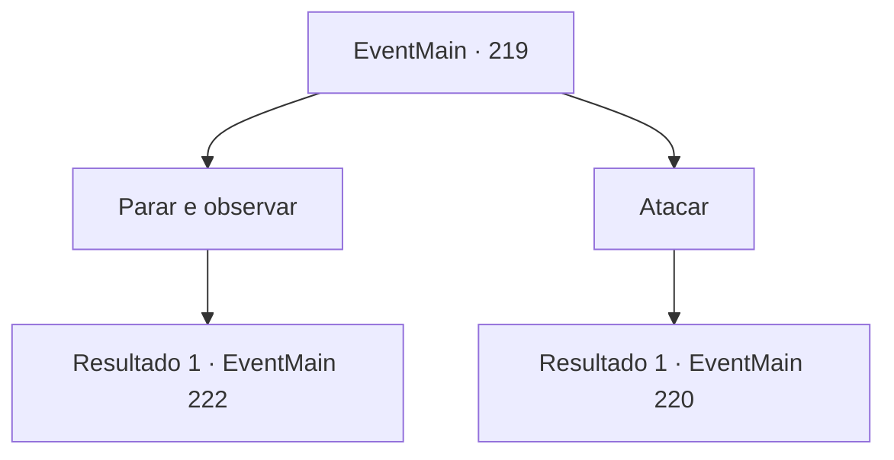

# Eventos principais · 219

[Índice da tabela](index.md) · [Índice geral](../index.md)

ID: `pt:EventMain:219` · Fonte: `EventMain4` · Versão: 1.2.47.

Mapeamento estático dos arquivos; a disponibilidade e a execução dependem do estado da run.

## Texto do evento

Num dia úmido e chuvoso, você alcança o pico da montanha Gar, sem dúvida uma árdua viagem. Então, encontra uma porta desguarnecida e desgastada. Pelo seu aspecto, a porta é velha tão velha quanto frágil. |drawing_mountainDoor| Em frente à porta está um grupo de aventureiros, mercenários e cavaleiros mortos. O príncipe da nação vizinha, Vertino, está vermelho enquanto tenta abrir a porta, e os seus cavaleiros acompanhantes pessoais estão ao seu lado, sem saberem o que fazer.

## Dados de entrada

```json
{
  "id": 219,
  "grade": 1,
  "normalGoal": "",
  "required": "13_2_4|1_2_55|5_135_1"
}
```

## Mapa das escolhas



## Escolhas e resultados

### Escolha 1

Parar e observar

Requisitos e outros campos da escolha:

```json
{
  "required": ""
}
```

#### Resultado 1.1

Você os vê fazendo tudo ao seu alcance para abrir aquela porta. <link=shake>

 "Maldição! Por que! Não vai! Você! Abra!"

</link> Vertino grita com voz irritada. Ele então desembainha sua espada e ataca um corpo próximo. Sua espada atravessa a armadura e rasga sua carne. Faíscas e respingos de sangue, e com um tinido, sua espada se quebra. Ele suspira e continua. 

 "Suspiro... nos retiramos por enquanto."

 Ele reúne seus homens e desce a montanha, falando sobre como ele deveria matar o ferreiro na cidade quando ele voltar. Depois que eles se vão, você fica na frente da porta surrada.

Continuação registrada: [Evento 222](0222.md) na mesma tabela.

```json
{
  "required": "",
  "chance": "1",
  "nextEvent": 222,
  "type": 2,
  "reward": ""
}
```

### Escolha 2

Atacar

Requisitos e outros campos da escolha:

```json
{
  "required": ""
}
```

#### Resultado 2.1

Você saca sua arma e ataca eles. A escolta de Vertino saca suas armas e o impede. 

 "Bom, bem quando eu estava chateado. Mate aquele idiota."


Continuação registrada: [Evento 220](0220.md) na mesma tabela.

```json
{
  "required": "",
  "chance": "1",
  "nextEvent": 220,
  "type": 2,
  "reward": "6_3_92",
  "place": 9
}
```

## Referências que chegam a este evento

Nenhum `nextEvent` positivo da mesma tabela aponta para este nó. Isso não prova que seja inacessível: sorteio e estado de história podem selecioná-lo.

