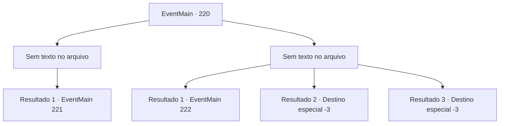

# Eventos principais · 220

[Índice da tabela](index.md) · [Índice geral](../index.md)

ID: `pt:EventMain:220` · Fonte: `EventMain4` · Versão: 1.2.47.

Mapeamento estático dos arquivos; a disponibilidade e a execução dependem do estado da run.

## Texto do evento

*Sem texto no arquivo.*

## Dados de entrada

```json
{
  "id": 220,
  "grade": 1,
  "normalGoal": "",
  "required": ""
}
```

## Mapa das escolhas



## Escolhas e resultados

### Escolha 1

*Sem texto no arquivo; o papel dessa opção depende da interface do jogo.*

Requisitos e outros campos da escolha:

```json
{
  "required": ""
}
```

#### Resultado 1.1

Você bateu em alguns dos cavaleiros da escolta. Eles gemem de dor, deitados no chão. Vertino resmunga para si mesmo, olhando ao redor. 

 "Droga... Você tem uma briga e tanto. Agora, então..."

 A princípio você pensa que ele não tem intenção de lutar, mas ele saca sua espada em um instante e a aponta para você.

Continuação registrada: [Evento 221](0221.md) na mesma tabela.

```json
{
  "required": "",
  "chance": "1",
  "nextEvent": 221,
  "type": 2,
  "reward": "0_3_-5|6_0_94",
  "place": 9
}
```

### Escolha 2

*Sem texto no arquivo; o papel dessa opção depende da interface do jogo.*

Requisitos e outros campos da escolha:

```json
{
  "required": ""
}
```

#### Resultado 2.1

Você luta contra os cavaleiros da escolta, mas acaba tropeçando, atingido por seus escudos. Algum tempo depois, você sente alguém lambendo seu rosto. Quando você abre os olhos, você vê uma enorme cabra da montanha lambendo você. Você tateia o queixo dolorido, fica de pé e sobe a montanha novamente. Vertino e seus homens devem ter ido embora, e a porta surrada ainda está fechada.

Continuação registrada: [Evento 222](0222.md) na mesma tabela.

```json
{
  "required": "1_1_2|1_0_2",
  "chance": "1",
  "nextEvent": 222,
  "type": 2,
  "reward": "0_0_-1|0_1_-1"
}
```

#### Resultado 2.2

Você luta contra os cavaleiros da escolta e paga o preço com sua vida.

Continuação registrada: [Destino especial `-3`](../destinos-especiais.md).

```json
{
  "required": "2_0_2",
  "chance": "1",
  "nextEvent": -3,
  "type": 2,
  "reward": "0_0_-1|0_1_-1"
}
```

#### Resultado 2.3

Você luta contra os cavaleiros da escolta e paga o preço com sua vida.

Continuação registrada: [Destino especial `-3`](../destinos-especiais.md).

```json
{
  "required": "2_1_2",
  "chance": "1",
  "nextEvent": -3,
  "type": 2,
  "reward": "0_0_-1|0_1_-1"
}
```

## Referências que chegam a este evento

- [Evento 219 · escolha 2 · resultado 1](0219.md#escolha-2)
