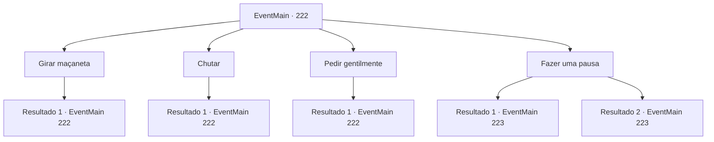

# Eventos principais · 222

[Índice da tabela](index.md) · [Índice geral](../index.md)

ID: `pt:EventMain:222` · Fonte: `EventMain4` · Versão: 1.2.47.

Mapeamento estático dos arquivos; a disponibilidade e a execução dependem do estado da run.

## Texto do evento

*Sem texto no arquivo.*

## Dados de entrada

```json
{
  "id": 222,
  "grade": 1,
  "normalGoal": "",
  "required": ""
}
```

## Mapa das escolhas



## Escolhas e resultados

### Escolha 1

Girar maçaneta

Requisitos e outros campos da escolha:

```json
{
  "required": "5_134_0"
}
```

#### Resultado 1.1

Você gira a maçaneta, como se estivesse abrindo uma porta comum. Mas a porta não se mexe.

Continuação registrada: [Evento 222](0222.md) na mesma tabela.

```json
{
  "required": "",
  "chance": "1",
  "nextEvent": 222,
  "type": 2,
  "reward": "5_134_1"
}
```

### Escolha 2

Chutar

Requisitos e outros campos da escolha:

```json
{
  "required": "5_134_1"
}
```

#### Resultado 2.1

Você chuta a porta com toda a sua força. A porta de madeira velha está imóvel, nem mesmo fazendo um som de rangido.

Continuação registrada: [Evento 222](0222.md) na mesma tabela.

```json
{
  "required": "",
  "chance": "1",
  "nextEvent": 222,
  "type": 2,
  "reward": "5_134_2"
}
```

### Escolha 3

Pedir gentilmente

Requisitos e outros campos da escolha:

```json
{
  "required": "5_134_2"
}
```

#### Resultado 3.1

Você faz algo que os outros achariam absurdo. Você pede educadamente para abrir a porta de madeira, mas não responde ao seu apelo. 

Continuação registrada: [Evento 222](0222.md) na mesma tabela.

```json
{
  "required": "",
  "chance": "1",
  "nextEvent": 222,
  "type": 2,
  "reward": "5_134_3"
}
```

### Escolha 4

Fazer uma pausa

Requisitos e outros campos da escolha:

```json
{
  "required": "5_134_3"
}
```

#### Resultado 4.1

Mesmo após várias tentativas, a porta não mostra sinais de abertura. Você recua por um momento. Ocorre a você que você pode ter que pensar em outra opção. Nesse momento, as palavras da bruxa cega vêm à sua mente.
 'Mergulhe a porta na água'

Continuação registrada: [Evento 223](0223.md) na mesma tabela.

```json
{
  "required": "5_231_1",
  "chance": "1",
  "nextEvent": 223,
  "type": 2,
  "reward": ""
}
```

#### Resultado 4.2

Mesmo após várias tentativas, a porta não mostra sinais de abertura. Você recua por um momento. Ocorre a você que você pode ter que pensar em outra opção.'

Continuação registrada: [Evento 223](0223.md) na mesma tabela.

```json
{
  "required": "18_231_1",
  "chance": "1",
  "nextEvent": 223,
  "type": 2,
  "reward": ""
}
```

## Referências que chegam a este evento

- [Evento 219 · escolha 1 · resultado 1](0219.md#escolha-1)
- [Evento 220 · escolha 2 · resultado 1](0220.md#escolha-2)
- [Evento 221 · escolha 2 · resultado 1](0221.md#escolha-2)
- [Evento 222 · escolha 1 · resultado 1](0222.md#escolha-1)
- [Evento 222 · escolha 2 · resultado 1](0222.md#escolha-2)
- [Evento 222 · escolha 3 · resultado 1](0222.md#escolha-3)
- [Evento 224 · escolha 1 · resultado 1](0224.md#escolha-1)
- [Evento 224 · escolha 3 · resultado 1](0224.md#escolha-3)
- [Evento 224 · escolha 4 · resultado 1](0224.md#escolha-4)
- [Evento 235 · escolha 1 · resultado 1](0235.md#escolha-1)
- [Evento 235 · escolha 3 · resultado 1](0235.md#escolha-3)
- [Evento 236 · escolha 2 · resultado 1](0236.md#escolha-2)
- [Evento 237 · escolha 2 · resultado 1](0237.md#escolha-2)
- [Evento 238 · escolha 1 · resultado 1](0238.md#escolha-1)
- [Evento 238 · escolha 3 · resultado 1](0238.md#escolha-3)
- [Evento 238 · escolha 4 · resultado 1](0238.md#escolha-4)
