# Eventos principais · 223

[Índice da tabela](index.md) · [Índice geral](../index.md)

ID: `pt:EventMain:223` · Fonte: `EventMain4` · Versão: 1.2.47.

Mapeamento estático dos arquivos; a disponibilidade e a execução dependem do estado da run.

## Texto do evento

*Sem texto no arquivo.*

## Dados de entrada

```json
{
  "id": 223,
  "grade": 1,
  "normalGoal": "",
  "required": ""
}
```

## Mapa das escolhas

```mermaid
flowchart TD
  E["EventMain · 223"]
  C0["Coletar água da chuva e jogar nela"]
  E --> C0
  R0_0["Resultado 1 · EventMain 223"]
  C0 --> R0_0
  C1["Tentar fazer uma poça d&#x27;água"]
  E --> C1
  R1_0["Resultado 1 · EventMain 225"]
  C1 --> R1_0
  R1_1["Resultado 2 · EventMain 225"]
  C1 --> R1_1
  C2["Tentar derrubar a porta"]
  E --> C2
  R2_0["Resultado 1 · EventMain 223"]
  C2 --> R2_0
  R2_1["Resultado 2 · EventMain 223"]
  C2 --> R2_1
  C3["Esperar mais"]
  E --> C3
  R3_0["Resultado 1 · Destino especial -2"]
  C3 --> R3_0
```



## Escolhas e resultados

### Escolha 1

Coletar água da chuva e jogar nela

Requisitos e outros campos da escolha:

```json
{
  "required": "5_147_0"
}
```

#### Resultado 1.1

Você tira uma de suas roupas e pega a água da chuva. E você joga na porta surrada. Mas ainda não abre.

Continuação registrada: [Evento 223](0223.md) na mesma tabela.

```json
{
  "required": "",
  "chance": "1",
  "nextEvent": 223,
  "type": 2,
  "reward": "5_147_1"
}
```

### Escolha 2

Tentar fazer uma poça d'água

Requisitos e outros campos da escolha:

```json
{
  "required": "5_231_1|1_14_10"
}
```

#### Resultado 2.1

Você tenta inventar alguma coisa. Talvez quando a porta for refletida na água, ela seja mergulhada na água. Com esse pensamento em mente, você cava um buraco largo e raso no chão. À medida que a água da chuva é coletada no furo, a água fica suja. Depois que a chuva termina e o dia fica claro novamente, a sujeira na água afunda e a poça fica clara. E aí a porta se reflete. A porta, agora na água, emite uma luz brilhante, escancarada.

Continuação registrada: [Evento 225](0225.md) na mesma tabela.

```json
{
  "required": "",
  "chance": "1",
  "nextEvent": 225,
  "type": 2,
  "reward": ""
}
```

#### Resultado 2.2

Você tenta inventar alguma coisa. Talvez quando a porta for refletida na água, ela seja mergulhada na água. Com esse pensamento em mente, você olha ao redor. Vários corpos deixados no chão, imóveis. Usando os corpos, você forma algo que se assemelha a um dique, preenchendo os buracos aqui e ali com suas roupas e armaduras. Você também decide ficar com uma das armaduras para você. Depois de um tempo de espera, a água da chuva é coletada, formando uma poça. Depois que a chuva termina e o dia fica claro novamente, a porta se reflete ali. A porta, agora na água, emite uma luz brilhante, escancarada.

Continuação registrada: [Evento 225](0225.md) na mesma tabela.

```json
{
  "required": "2_3_0",
  "chance": "1",
  "nextEvent": 225,
  "type": 2,
  "reward": "3_84_1|0_3_-2"
}
```

### Escolha 3

Tentar derrubar a porta

Requisitos e outros campos da escolha:

```json
{
  "required": "5_148_0|5_231_1"
}
```

#### Resultado 3.1

Está chovendo afinal, e talvez quebrar as pedras ao redor da porta e derrubá-la é como você a mergulha na água. Com esse pensamento em mente, você pega nossa picareta. Então você bate nas pedras ao redor da porta. Mas a picareta não quebra as rochas resistentes e é desviada.

Continuação registrada: [Evento 223](0223.md) na mesma tabela.

```json
{
  "required": "8_44_1",
  "chance": "1",
  "nextEvent": 223,
  "type": 2,
  "reward": "5_148_1"
}
```

#### Resultado 3.2

Está chovendo afinal, e talvez quebrar as pedras ao redor da porta e derrubá-la é como você a mergulha na água. Com esse pensamento em mente, você procura uma ferramenta para quebrar as rochas, mas nada parece adequado para o trabalho.

Continuação registrada: [Evento 223](0223.md) na mesma tabela.

```json
{
  "required": "",
  "chance": "1",
  "nextEvent": 223,
  "type": 2,
  "reward": "5_148_1"
}
```

### Escolha 4

Esperar mais

Requisitos e outros campos da escolha:

```json
{
  "required": ""
}
```

#### Resultado 4.1

Você continua esperando a porta se abrir. Muitos aventureiros e cavaleiros chegam atrás de você, na frente da porta, mas ninguém consegue abrir essa porta. Enquanto você espera por vários dias, a neve branca começa a se acumular em sua cabeça. O vento corta sua pele como lâminas afiadas. Infelizmente, você desiste de abrir a porta e desce a montanha.

Continuação registrada: [Destino especial `-2`](../destinos-especiais.md).

```json
{
  "required": "",
  "chance": "1",
  "nextEvent": -2,
  "type": 2,
  "reward": "13_2_9"
}
```

## Referências que chegam a este evento

- [Evento 222 · escolha 4 · resultado 1](0222.md#escolha-4)
- [Evento 222 · escolha 4 · resultado 2](0222.md#escolha-4)
- [Evento 223 · escolha 1 · resultado 1](0223.md#escolha-1)
- [Evento 223 · escolha 3 · resultado 1](0223.md#escolha-3)
- [Evento 223 · escolha 3 · resultado 2](0223.md#escolha-3)
