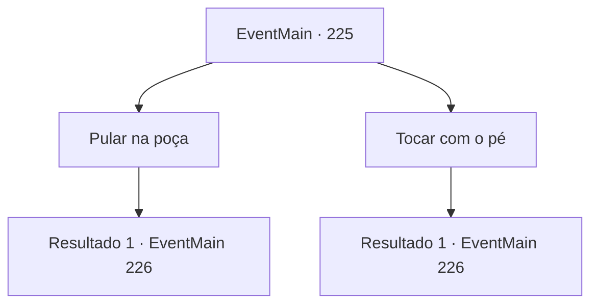

# Eventos principais · 225

[Índice da tabela](index.md) · [Índice geral](../index.md)

ID: `pt:EventMain:225` · Fonte: `EventMain4` · Versão: 1.2.47.

Mapeamento estático dos arquivos; a disponibilidade e a execução dependem do estado da run.

## Texto do evento

*Sem texto no arquivo.*

## Dados de entrada

```json
{
  "id": 225,
  "grade": 1,
  "normalGoal": "",
  "required": ""
}
```

## Mapa das escolhas



## Escolhas e resultados

### Escolha 1

Pular na poça

Requisitos e outros campos da escolha:

```json
{
  "required": ""
}
```

#### Resultado 1.1

No momento em que você pula, a poça de repente se torna um lago, sua profundidade insondável. Você nada em direção à porta, ainda emitindo luz. Quando você fecha e abre os olhos de uma breve náusea, de repente você percebe que está dentro de um grande espaço oco. É construído com pedra branca, com uma luz laranja fraca iluminando o interior luxuosamente. |drawing_steelDragonLair| Um dragão cinza está olhando para você. Parece surpreso que você chegou aqui, como se não esperasse sua presença.

Continuação registrada: [Evento 226](0226.md) na mesma tabela.

```json
{
  "required": "",
  "chance": "1",
  "nextEvent": 226,
  "type": 2,
  "reward": ""
}
```

### Escolha 2

Tocar com o pé

Requisitos e outros campos da escolha:

```json
{
  "required": ""
}
```

#### Resultado 2.1

Se fosse de fato uma poça rasa, seus pés chegariam ao fundo, mas, ao contrário de sua expectativa, seus pés não tocariam o fundo. Você cai na poça, e de repente ela se torna um lago de profundidade insondável. Não há como voltar agora, então você nada em direção à porta, ainda emitindo luz. Quando você fecha e abre os olhos de uma breve náusea, de repente você percebe que está dentro de um grande espaço oco. É construído com pedra branca, com uma luz laranja fraca iluminando o interior luxuosamente. |drawing_steelDragonLair| Um dragão cinza está olhando para você. Parece surpreso que você chegou aqui, como se não esperasse sua presença.

Continuação registrada: [Evento 226](0226.md) na mesma tabela.

```json
{
  "required": "",
  "chance": "1",
  "nextEvent": 226,
  "type": 2,
  "reward": ""
}
```

## Referências que chegam a este evento

- [Evento 223 · escolha 2 · resultado 1](0223.md#escolha-2)
- [Evento 223 · escolha 2 · resultado 2](0223.md#escolha-2)
