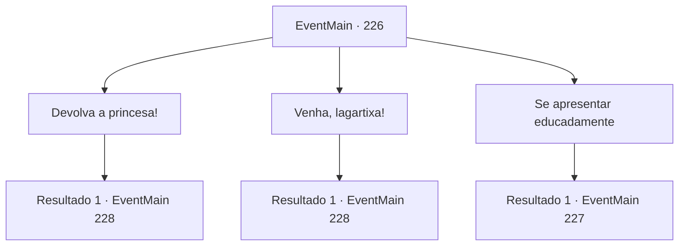

# Eventos principais · 226

[Índice da tabela](index.md) · [Índice geral](../index.md)

ID: `pt:EventMain:226` · Fonte: `EventMain4` · Versão: 1.2.47.

Mapeamento estático dos arquivos; a disponibilidade e a execução dependem do estado da run.

## Texto do evento

*Sem texto no arquivo.*

## Dados de entrada

```json
{
  "id": 226,
  "grade": 1,
  "normalGoal": "",
  "required": ""
}
```

## Mapa das escolhas



## Escolhas e resultados

### Escolha 1

Devolva a princesa!

Requisitos e outros campos da escolha:

```json
{
  "required": ""
}
```

#### Resultado 1.1

Você exige que o dragão devolva a princesa. Ele responde prometendo que se você vencê-lo em uma luta, a princesa será devolvida. Você saca sua arma, pronto para colocar sua vida em risco.

Continuação registrada: [Evento 228](0228.md) na mesma tabela.

```json
{
  "required": "",
  "chance": "1",
  "nextEvent": 228,
  "type": 2,
  "reward": "6_0_93",
  "place": 6
}
```

### Escolha 2

Venha, lagartixa!

Requisitos e outros campos da escolha:

```json
{
  "required": ""
}
```

#### Resultado 2.1

Você ataca o dragão com sua arma em punho. O dragão diz para você tornar a luta interessante, observando sua bravura.

Continuação registrada: [Evento 228](0228.md) na mesma tabela.

```json
{
  "required": "",
  "chance": "1",
  "nextEvent": 228,
  "type": 2,
  "reward": "6_0_93",
  "place": 6
}
```

### Escolha 3

Se apresentar educadamente

Requisitos e outros campos da escolha:

```json
{
  "required": "1_7_15"
}
```

#### Resultado 3.1

Você percebe que o dragão diante de seus olhos é um 'Dragão de Aço'. Esse tipo de dragão é muito amigável com os humanos, a ponto de considerá-los fofos. Você educadamente cumprimenta o dragão, e ele responde a você com uma voz grave e grave que sacode o ar. 

 "Qual é o motivo da sua visita ao meu covil?"

 Você diz ao dragão que está aqui para a princesa sequestrada. O dragão promete que devolverá a princesa se você vencê-lo em uma luta.

Continuação registrada: [Evento 227](0227.md) na mesma tabela.

```json
{
  "required": "",
  "chance": "1",
  "nextEvent": 227,
  "type": 2,
  "reward": ""
}
```

## Referências que chegam a este evento

- [Evento 225 · escolha 1 · resultado 1](0225.md#escolha-1)
- [Evento 225 · escolha 2 · resultado 1](0225.md#escolha-2)
