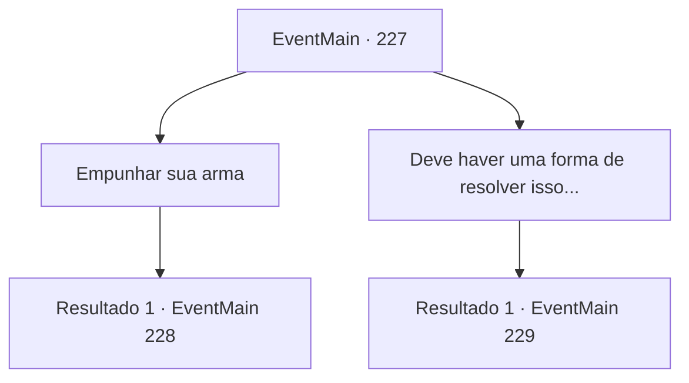

# Eventos principais · 227

[Índice da tabela](index.md) · [Índice geral](../index.md)

ID: `pt:EventMain:227` · Fonte: `EventMain4` · Versão: 1.2.47.

Mapeamento estático dos arquivos; a disponibilidade e a execução dependem do estado da run.

## Texto do evento

*Sem texto no arquivo.*

## Dados de entrada

```json
{
  "id": 227,
  "grade": 1,
  "normalGoal": "",
  "required": ""
}
```

## Mapa das escolhas



## Escolhas e resultados

### Escolha 1

Empunhar sua arma

Requisitos e outros campos da escolha:

```json
{
  "required": ""
}
```

#### Resultado 1.1

Você saca sua arma, pronto para colocar sua vida em risco. Você decide lutar contra o dragão. 

Continuação registrada: [Evento 228](0228.md) na mesma tabela.

```json
{
  "required": "",
  "chance": "1",
  "nextEvent": 228,
  "type": 2,
  "reward": "6_0_93",
  "place": 6
}
```

### Escolha 2

Deve haver uma forma de resolver isso...

Requisitos e outros campos da escolha:

```json
{
  "required": ""
}
```

#### Resultado 2.1

Você toca suavemente a pata dianteira do dragão, lisonjeando-o. O dragão de aço olha para você e sorri brincando. Então, das costas do dragão aparece a princesa. 

 "O que você está fazendo aqui...?"

 Ela olha para você e pergunta, com um olhar surpreso no rosto. O dragão, em um instante, se transforma em sua forma humana, que é o capitão real da Guarda, Egakin.

Continuação registrada: [Evento 229](0229.md) na mesma tabela.

```json
{
  "required": "",
  "chance": "1",
  "nextEvent": 229,
  "type": 2,
  "reward": ""
}
```

## Referências que chegam a este evento

- [Evento 226 · escolha 3 · resultado 1](0226.md#escolha-3)
