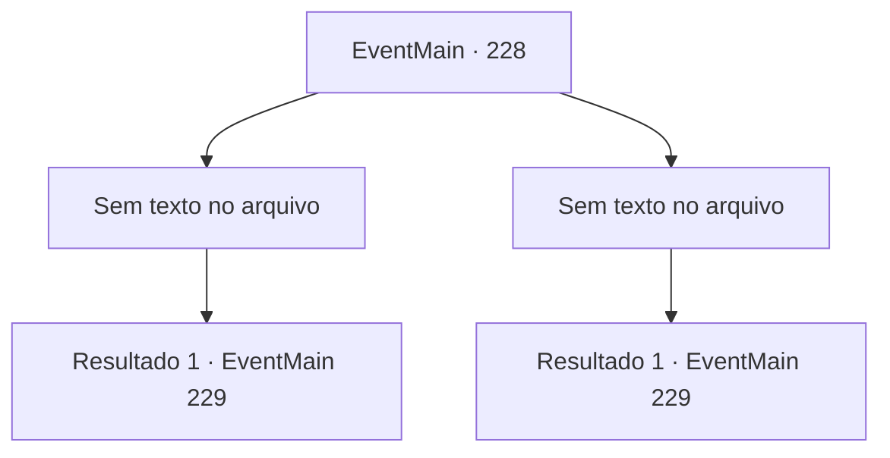

# Eventos principais · 228

[Índice da tabela](index.md) · [Índice geral](../index.md)

ID: `pt:EventMain:228` · Fonte: `EventMain4` · Versão: 1.2.47.

Mapeamento estático dos arquivos; a disponibilidade e a execução dependem do estado da run.

## Texto do evento

*Sem texto no arquivo.*

## Dados de entrada

```json
{
  "id": 228,
  "grade": 1,
  "normalGoal": "",
  "required": ""
}
```

## Mapa das escolhas



## Escolhas e resultados

### Escolha 1

*Sem texto no arquivo; o papel dessa opção depende da interface do jogo.*

Requisitos e outros campos da escolha:

```json
{
  "required": ""
}
```

#### Resultado 1.1

A cada segundo que você está lutando contra o dragão, você tem a impressão de que ele não está usando todo o seu poder. Ele o aplaude com palavras, como se estivesse satisfeito. 

 "Excelente. De todos os humanos que enfrentei até agora, você pode ser um entre os de nível superior."

 Então, das costas do dragão aparece a princesa. 

 "Velhote! Espere um segundo! O que você está fazendo aqui..?"

 Ela olha para você e pergunta, com um olhar surpreso no rosto. O dragão, em um instante, se transforma em sua forma humana, que é o capitão real da Guarda, Egakin. Egakin murmura em voz baixa que ele não tinha intenção de matá-lo em primeiro lugar.

Continuação registrada: [Evento 229](0229.md) na mesma tabela.

```json
{
  "required": "",
  "chance": "1",
  "nextEvent": 229,
  "type": 2,
  "reward": ""
}
```

### Escolha 2

*Sem texto no arquivo; o papel dessa opção depende da interface do jogo.*

Requisitos e outros campos da escolha:

```json
{
  "required": ""
}
```

#### Resultado 2.1

Seus ataques não podem nem arranhar a pele do dragão. Além disso, a cada segundo que você está lutando contra o dragão, você tem a impressão de que ele não está usando todo o seu poder. Como você está respirando pesadamente, da parte de trás do dragão aparece a princesa. 

 "Velhote! Espere um segundo! O que você está fazendo aqui..?"

 Ela olha para você e pergunta, com um olhar surpreso no rosto. O dragão, em um instante, se transforma em sua forma humana, que é o capitão real da Guarda, Egakin. Egakin murmura que ele não tinha intenção de matá-lo em primeiro lugar.

Continuação registrada: [Evento 229](0229.md) na mesma tabela.

```json
{
  "required": "",
  "chance": "1",
  "nextEvent": 229,
  "type": 2,
  "reward": "0_2_1"
}
```

## Referências que chegam a este evento

- [Evento 226 · escolha 1 · resultado 1](0226.md#escolha-1)
- [Evento 226 · escolha 2 · resultado 1](0226.md#escolha-2)
- [Evento 227 · escolha 1 · resultado 1](0227.md#escolha-1)
