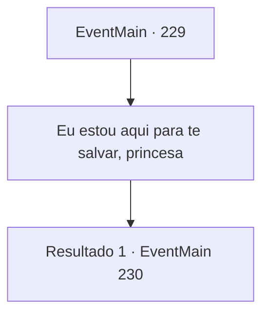

# Eventos principais · 229

[Índice da tabela](index.md) · [Índice geral](../index.md)

ID: `pt:EventMain:229` · Fonte: `EventMain4` · Versão: 1.2.47.

Mapeamento estático dos arquivos; a disponibilidade e a execução dependem do estado da run.

## Texto do evento

*Sem texto no arquivo.*

## Dados de entrada

```json
{
  "id": 229,
  "grade": 1,
  "normalGoal": "",
  "required": ""
}
```

## Mapa das escolhas



## Escolhas e resultados

### Escolha 1

Eu estou aqui para te salvar, princesa

Requisitos e outros campos da escolha:

```json
{
  "required": ""
}
```

#### Resultado 1.1

Você diz a ela que pensou que a princesa foi sequestrada por um dragão e está aqui para salvá-la. 

 "Ah, me desculpe... Você percorreu um longo caminho para nada por minha causa. Você se sentaria?"

 Ela gesticula para a pequena mesa e cadeiras, agora visíveis com o dragão desaparecido, e pede para você se sentar. Você faz o que ela diz e senta em uma das cadeiras. A princesa se senta no lado oposto da mesa e diz para você perguntar tudo o que quiser saber. Você recorda brevemente as memórias de você e da princesa na biblioteca, fazendo perguntas um ao outro.

Continuação registrada: [Evento 230](0230.md) na mesma tabela.

```json
{
  "required": "",
  "chance": "1",
  "nextEvent": 230,
  "type": 2,
  "reward": ""
}
```

## Referências que chegam a este evento

- [Evento 227 · escolha 2 · resultado 1](0227.md#escolha-2)
- [Evento 228 · escolha 1 · resultado 1](0228.md#escolha-1)
- [Evento 228 · escolha 2 · resultado 1](0228.md#escolha-2)
