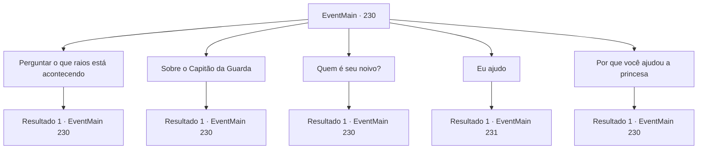

# Eventos principais · 230

[Índice da tabela](index.md) · [Índice geral](../index.md)

ID: `pt:EventMain:230` · Fonte: `EventMain4` · Versão: 1.2.47.

Mapeamento estático dos arquivos; a disponibilidade e a execução dependem do estado da run.

## Texto do evento

*Sem texto no arquivo.*

## Dados de entrada

```json
{
  "id": 230,
  "grade": 1,
  "normalGoal": "",
  "required": ""
}
```

## Mapa das escolhas



## Escolhas e resultados

### Escolha 1

Perguntar o que raios está acontecendo

Requisitos e outros campos da escolha:

```json
{
  "required": "5_136_0"
}
```

#### Resultado 1.1

A princesa responde suas perguntas com entusiasmo. Segundo ela, ela tinha uma irmã mais velha que estava noiva por motivos políticos e, no final de sua infeliz vida de casada, se suicidou. 

 "Sua Majestade pretende me usar como moeda de troca para ganhar o controle da nação vizinha... mas eu me recuso a ser usado como seu fantoche. Vou me casar com a pessoa com quem quero me casar. Então, com a ajuda do Capitão da Guarda, eu mesmo escapei do palácio."

 Depois de terminar, a princesa suspira e acrescenta que não tem intenção de voltar ao palácio real.

Continuação registrada: [Evento 230](0230.md) na mesma tabela.

```json
{
  "required": "",
  "chance": "1",
  "nextEvent": 230,
  "type": 2,
  "reward": "5_136_1"
}
```

### Escolha 2

Sobre o Capitão da Guarda

Requisitos e outros campos da escolha:

```json
{
  "required": "5_137_0"
}
```

#### Resultado 2.1

Você pergunta sobre a verdadeira identidade do Capitão da Guarda. O capitão, ao lado da princesa, fala depois de um suspiro. 

 "Um dragão, como você pode ver. Um Dragão de Aço. Eu tenho vivido entre o seu tipo por curiosidade pela vida humana."

 Ele também diz que faz cerca de um século desde que ele se misturou, e que desta vez, ele escolheu o papel do cavaleiro real porque estava curioso sobre a vida da realeza. Com suas habilidades, seria uma questão de tempo até que ele fosse promovido a capitão.

Continuação registrada: [Evento 230](0230.md) na mesma tabela.

```json
{
  "required": "",
  "chance": "1",
  "nextEvent": 230,
  "type": 2,
  "reward": "5_137_1"
}
```

### Escolha 3

Quem é seu noivo?

Requisitos e outros campos da escolha:

```json
{
  "required": "5_138_0"
}
```

#### Resultado 3.1

Você pergunta a ela quem o Imperador pensava como seu noivo. Ela franze a testa, como se estivesse ficando irritada só de pensar nisso. 

 "É Vertino, o herdeiro ruivo do Reino de Arma. A crueldade daquele homem não tem limites - espancando uma das empregadas até a morte só porque ela não conseguiu acertar a temperatura da água do banho dele, deixando reféns de guerra empalados em lanças nos campos de batalha. E aparentemente ele também é habilidoso, sendo um dos poucos matadores de dragões neste continente."

 Ela coça um lado da cabeça um pouco, depois continua. 

 "Ele uma vez me viu em um baile e desde então pede minha mão em casamento. Sua Majestade provavelmente quer pegar Arma, mas não quer arriscar muito perder contra um guerreiro forte como Vertino... Acho que ele está tentando me casar com ele. Uma situação ganha-ganha. Exceto para mim."


Continuação registrada: [Evento 230](0230.md) na mesma tabela.

```json
{
  "required": "",
  "chance": "1",
  "nextEvent": 230,
  "type": 2,
  "reward": "5_138_1"
}
```

### Escolha 4

Eu ajudo

Requisitos e outros campos da escolha:

```json
{
  "required": "5_136_1"
}
```

#### Resultado 4.1

Você diz que vai ajudar a princesa a se casar com quem ela quiser. Então, o Capitão dos Guardas pergunta como você pode ajudar. 

Continuação registrada: [Evento 231](0231.md) na mesma tabela.

```json
{
  "required": "",
  "chance": "1",
  "nextEvent": 231,
  "type": 2,
  "reward": ""
}
```

### Escolha 5

Por que você ajudou a princesa

Requisitos e outros campos da escolha:

```json
{
  "required": "5_143_0"
}
```

#### Resultado 5.1

Você pergunta a Egakin por que ele ajudou a princesa. Ele responde como se tivesse feito o que precisava ser feito. 

 "Eu cuidei de Esit desde que ela era uma garotinha. Como uma filha. Quando aquele garoto vem até mim e implora em lágrimas, eu não poderia simplesmente dizer não. Então eu revelei minha identidade e a tirei do castelo."


Continuação registrada: [Evento 230](0230.md) na mesma tabela.

```json
{
  "required": "",
  "chance": "1",
  "nextEvent": 230,
  "type": 2,
  "reward": "5_143_1"
}
```

## Referências que chegam a este evento

- [Evento 229 · escolha 1 · resultado 1](0229.md#escolha-1)
- [Evento 230 · escolha 1 · resultado 1](0230.md#escolha-1)
- [Evento 230 · escolha 2 · resultado 1](0230.md#escolha-2)
- [Evento 230 · escolha 3 · resultado 1](0230.md#escolha-3)
- [Evento 230 · escolha 5 · resultado 1](0230.md#escolha-5)
