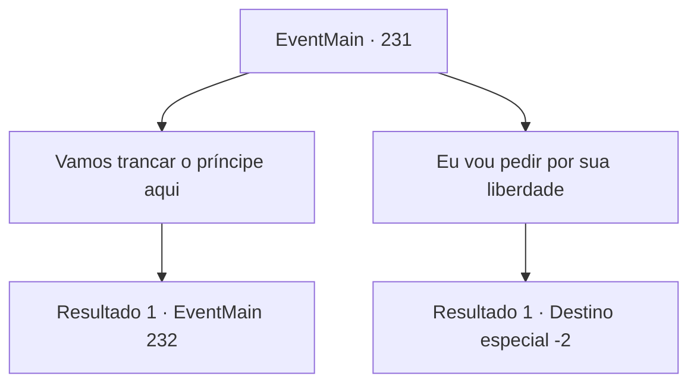

# Eventos principais · 231

[Índice da tabela](index.md) · [Índice geral](../index.md)

ID: `pt:EventMain:231` · Fonte: `EventMain4` · Versão: 1.2.47.

Mapeamento estático dos arquivos; a disponibilidade e a execução dependem do estado da run.

## Texto do evento

*Sem texto no arquivo.*

## Dados de entrada

```json
{
  "id": 231,
  "grade": 1,
  "normalGoal": "",
  "required": ""
}
```

## Mapa das escolhas



## Escolhas e resultados

### Escolha 1

Vamos trancar o príncipe aqui

Requisitos e outros campos da escolha:

```json
{
  "required": "5_135_1"
}
```

#### Resultado 1.1

Você notifica a princesa das condições que o Imperador estabeleceu, e que veio Vertino, seguindo os rastros do dragão. Você também diz a ela que, como ele ainda está descendo a montanha, seria possível atraí-lo e trancá-lo aqui por um tempo. 

 "Entendo... Sem ele, o casamento diplomático será paralisado. Talvez se torne totalmente inválido. Parece uma boa ideia ganhar algum tempo e persuadir o Imperador."

 O capitão concorda com a sua opinião. Você e a princesa saem do covil e se escondem atrás das rochas. Egakin, que agora se transformou de volta à sua forma de dragão, solta um rugido. <color=red><link=shake>

 "KRAAAAARGH!!!"

</link></color> O rugido triunfante do dragão ecoa por toda a montanha. Logo, ele sai do covil em sua forma humana, deixa a porta aberta e vem se esconder ao seu lado.

Continuação registrada: [Evento 232](0232.md) na mesma tabela.

```json
{
  "required": "",
  "chance": "1",
  "nextEvent": 232,
  "type": 2,
  "reward": ""
}
```

### Escolha 2

Eu vou pedir por sua liberdade

Requisitos e outros campos da escolha:

```json
{
  "required": ""
}
```

#### Resultado 2.1

Você notifica a princesa das condições que o Imperador estabeleceu. Você diz que desejará que o Imperador dê liberdade à princesa. Depois de ouvir você, ela se recosta na cadeira, com um 'Hmm..'. 

 "Agradeço sua sugestão... mas devo considerar isso por mais tempo. Dê-me algum tempo, por favor."

 Ela lhe diz que o avisará com um pombo-correio quando decidir. Então ela tira uma poção de uma gaveta, entrega para você e fala. 

 "Me desculpe por não ter avisado com antecedência... Eu só não esperava que você viesse me encontrar assim."

 A poção que ela lhe deu claramente pertence a Egakin, mas ele não diz uma palavra. Você decide esperar pela decisão da princesa e sair do covil do dragão com a poção.

Continuação registrada: [Destino especial `-2`](../destinos-especiais.md).

```json
{
  "required": "",
  "chance": "1",
  "nextEvent": -2,
  "type": 2,
  "reward": "13_2_5|3_130_1|0_2_2"
}
```

## Referências que chegam a este evento

- [Evento 230 · escolha 4 · resultado 1](0230.md#escolha-4)
