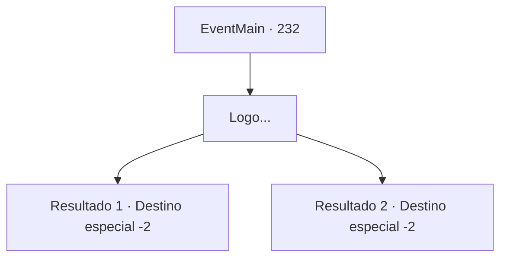

# Eventos principais · 232

[Índice da tabela](index.md) · [Índice geral](../index.md)

ID: `pt:EventMain:232` · Fonte: `EventMain4` · Versão: 1.2.47.

Mapeamento estático dos arquivos; a disponibilidade e a execução dependem do estado da run.

## Texto do evento

*Sem texto no arquivo.*

## Dados de entrada

```json
{
  "id": 232,
  "grade": 1,
  "normalGoal": "",
  "required": ""
}
```

## Mapa das escolhas



## Escolhas e resultados

### Escolha 1

Logo...

Requisitos e outros campos da escolha:

```json
{
  "required": ""
}
```

#### Resultado 1.1

Depois de uma curta espera, você pode ouvir os passos de várias pessoas. Liderando-os pela frente está o ruivo Vertino. Quando ele vê a porta aberta com as luzes saindo, ele grita com uma voz irritada. 

 "Poderia ter aberto mais cedo! Maldita mão de obra desperdiçada aqui."

 Ele leva seus homens para a porta. Assim que todos eles entram no covil, o Capitão arromba a entrada, selando-o completamente com os detritos caídos. 

 "Obrigado pela ajuda, {1}. Agora então... Vejo você na capital 'Zapen'. Tenho um lugar para visitar antes de retornar ao palácio."

 A princesa acena com a mão graciosamente, se despedindo de você.

Continuação registrada: [Destino especial `-2`](../destinos-especiais.md).

```json
{
  "required": "18_135_2",
  "chance": "1",
  "nextEvent": -2,
  "type": 2,
  "reward": "13_2_8|0_2_2|5_135_3"
}
```

#### Resultado 1.2

Depois de uma curta espera, você pode ouvir os passos de várias pessoas. Liderando-os pela frente está o ruivo Vertino. Quando ele vê a porta aberta com as luzes saindo, ele fala baixinho. 

 "Aquele bastardo deve ter aberto a porta e entrado. Ei! Você aí. Lidere o caminho."

 Ele envia seus cavaleiros primeiro e entra pela porta por último. Assim que todos eles entram no covil, o Capitão arromba a entrada, selando-o completamente com os detritos caídos. 

 "Obrigado pela ajuda, {1}. Agora então... Vejo você na capital 'Zapen'. Tenho um lugar para visitar antes de retornar ao palácio."

 A princesa acena com a mão graciosamente, se despedindo de você.

Continuação registrada: [Destino especial `-2`](../destinos-especiais.md).

```json
{
  "required": "5_135_2",
  "chance": "1",
  "nextEvent": -2,
  "type": 2,
  "reward": "13_2_8|0_2_2|5_135_3"
}
```

## Referências que chegam a este evento

- [Evento 231 · escolha 1 · resultado 1](0231.md#escolha-1)
