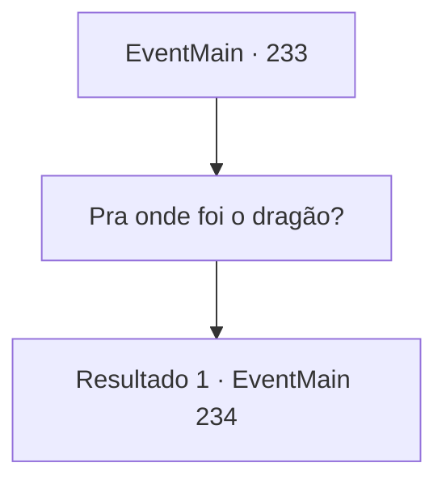

# Eventos principais · 233

[Índice da tabela](index.md) · [Índice geral](../index.md)

ID: `pt:EventMain:233` · Fonte: `EventMain4` · Versão: 1.2.47.

Mapeamento estático dos arquivos; a disponibilidade e a execução dependem do estado da run.

## Texto do evento

Caminhando na direção que o dragão voou, você se depara com um idoso, grunindo com a mão nas costas. Ele se apresenta. Segundo ele, ele é um pastor de cabras, que cria cabras da montanha, e sempre está viajando através de muitas montanhas. Diz que estava a pastorando cabras como de costume, quando de repente viu um dragão cobrindo o céu, o fazendo cair de surpresa.  Levando em conta suas costas, parece que ele não vai conseguir pastorar as cabras por algum tempo.

## Dados de entrada

```json
{
  "id": 233,
  "grade": 1,
  "normalGoal": "",
  "required": "13_2_3|1_2_30"
}
```

## Mapa das escolhas



## Escolhas e resultados

### Escolha 1

Pra onde foi o dragão?

Requisitos e outros campos da escolha:

```json
{
  "required": ""
}
```

#### Resultado 1.1

Você pergunta ao velho pastor sobre o paradeiro do dragão. Ele franze a testa com mais força e abre a boca. 

 "Ugh, minhas costas... Se você me ajudar a pastorear as cabras da montanha, algo pode vir à minha mente..."


Continuação registrada: [Evento 234](0234.md) na mesma tabela.

```json
{
  "required": "",
  "chance": "1",
  "nextEvent": 234,
  "type": 2,
  "reward": ""
}
```

## Referências que chegam a este evento

Nenhum `nextEvent` positivo da mesma tabela aponta para este nó. Isso não prova que seja inacessível: sorteio e estado de história podem selecioná-lo.

