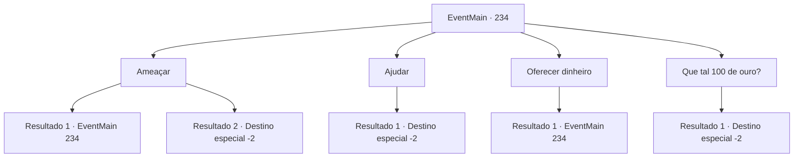

# Eventos principais · 234

[Índice da tabela](index.md) · [Índice geral](../index.md)

ID: `pt:EventMain:234` · Fonte: `EventMain4` · Versão: 1.2.47.

Mapeamento estático dos arquivos; a disponibilidade e a execução dependem do estado da run.

## Texto do evento

*Sem texto no arquivo.*

## Dados de entrada

```json
{
  "id": 234,
  "grade": 1,
  "normalGoal": "",
  "required": ""
}
```

## Mapa das escolhas



## Escolhas e resultados

### Escolha 1

Ameaçar

Requisitos e outros campos da escolha:

```json
{
  "required": "5_139_0"
}
```

#### Resultado 1.1

Você tenta ameaçar o velho para dar informações. Mas ele nem vacila com a sua intimidação e começa a se deitar no chão. 

 "Ooh, estou com tanto medo~ Estou com tanto medo que esqueci onde o dragão foi~"

 Talvez você devesse tentar uma abordagem diferente.

Continuação registrada: [Evento 234](0234.md) na mesma tabela.

```json
{
  "required": "",
  "chance": "13",
  "nextEvent": 234,
  "type": 1,
  "reward": "5_139_1"
}
```

#### Resultado 1.2

Você ameaça o velho, fazendo uma cara assustadora. O velho aponta para sudeste com os dedos, tremendo. 

 "T..Ali. Ele voou até o pico da montanha Gar..."

 Você segue em direção à montanha Gar, como o velho lhe disse.

Continuação registrada: [Destino especial `-2`](../destinos-especiais.md).

```json
{
  "required": "",
  "chance": "1|0_12_1",
  "nextEvent": -2,
  "type": 0,
  "reward": "13_2_4|0_2_1|5_140_2"
}
```

### Escolha 2

Ajudar

Requisitos e outros campos da escolha:

```json
{
  "required": ""
}
```

#### Resultado 2.1

O velho te dá uma isca vermelha que faz sons, e lhe diz que você será capaz de chamar a atenção das cabras da montanha se você agitá-lo. 

 "Mas, se você agitá-lo muito rápido, as cabras irão em sua direção, então é importante agitá-lo em uma velocidade apropriada."

 Você pega a isca vermelha e a sacode lentamente. Uma manada de enormes cabras montesas, de tamanho quase tão grande quanto a sua altura, começa a segui-lo lentamente. 

 Depois de horas de pastoreio, você finalmente chega ao seu destino com as cabras da montanha. O velho pastor agradece seu trabalho e diz que o dragão parecia estar voando em direção ao pico da montanha Gar. Você segue em direção à montanha Gar, como o velho lhe disse.

Continuação registrada: [Destino especial `-2`](../destinos-especiais.md).

```json
{
  "required": "",
  "chance": "1",
  "nextEvent": -2,
  "type": 2,
  "reward": "13_2_4|5_140_1|0_2_1"
}
```

### Escolha 3

Oferecer dinheiro

Requisitos e outros campos da escolha:

```json
{
  "required": "5_141_0"
}
```

#### Resultado 3.1

Você pergunta ao velho quanto vale a informação em ouro. Mas o velho pastor fica muito zangado. 

 "Você mimou pouco...! Que tipo de pessoa você acha que eu sou! Acabe com as bobagens e agrupe as cabras da montanha! Ou simplesmente vá embora!"

 Talvez você devesse tentar uma abordagem diferente.

Continuação registrada: [Evento 234](0234.md) na mesma tabela.

```json
{
  "required": "",
  "chance": "1",
  "nextEvent": 234,
  "type": 2,
  "reward": "5_141_1"
}
```

### Escolha 4

Que tal 100 de ouro?

Requisitos e outros campos da escolha:

```json
{
  "required": "5_141_1|1_4_100"
}
```

#### Resultado 4.1

Você diz a ele que está disposto a comprar a informação com 100 de ouro. O velho de repente fica em silêncio e murmura para si mesmo: 'Isso não é pouca coisa...'. Ele então aponta para sudeste e diz que o dragão voou em direção ao pico da montanha Gar. Você segue em direção à montanha Gar, como o velho lhe disse.

Continuação registrada: [Destino especial `-2`](../destinos-especiais.md).

```json
{
  "required": "",
  "chance": "1",
  "nextEvent": -2,
  "type": 2,
  "reward": "13_2_4|0_2_1|0_4_-100|0_12_1|5_140_2"
}
```

## Referências que chegam a este evento

- [Evento 233 · escolha 1 · resultado 1](0233.md#escolha-1)
- [Evento 234 · escolha 1 · resultado 1](0234.md#escolha-1)
- [Evento 234 · escolha 3 · resultado 1](0234.md#escolha-3)
