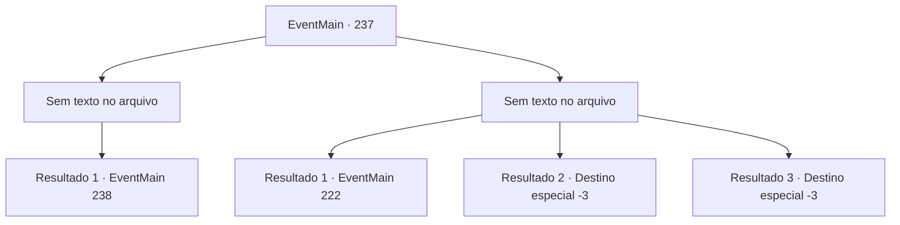

# Eventos principais · 237

[Índice da tabela](index.md) · [Índice geral](../index.md)

ID: `pt:EventMain:237` · Fonte: `EventMain4` · Versão: 1.2.47.

Mapeamento estático dos arquivos; a disponibilidade e a execução dependem do estado da run.

## Texto do evento

*Sem texto no arquivo.*

## Dados de entrada

```json
{
  "id": 237,
  "grade": 1,
  "normalGoal": "",
  "required": ""
}
```

## Mapa das escolhas



## Escolhas e resultados

### Escolha 1

*Sem texto no arquivo; o papel dessa opção depende da interface do jogo.*

Requisitos e outros campos da escolha:

```json
{
  "required": ""
}
```

#### Resultado 1.1


 "Huh... Você tem habilidade, eu vou te dar isso."

 Você e Vertino respiram pesadamente. Enquanto você está ocupado lutando contra ele, seus cavaleiros de escolta estão cuidando dos feridos. Vertino olha em volta e embainha sua espada. 

 "Isto é suficiente. Não vou incomodá-lo de tentar abrir aquela porta. Eu não vejo mais o sentido dessa luta."


Continuação registrada: [Evento 238](0238.md) na mesma tabela.

```json
{
  "required": "",
  "chance": "1",
  "nextEvent": 238,
  "type": 2,
  "reward": ""
}
```

### Escolha 2

*Sem texto no arquivo; o papel dessa opção depende da interface do jogo.*

Requisitos e outros campos da escolha:

```json
{
  "required": ""
}
```

#### Resultado 2.1

Vertino caminha lentamente em sua direção, que agora está deitado no chão, e chuta você com toda a força. Você cai das montanhas e fica inconsciente. Algum tempo depois, você sente alguém lambendo seu rosto. Quando você abre os olhos, você vê uma enorme cabra da montanha lambendo você. Você tateia o queixo dolorido, fica de pé e sobe a montanha novamente. Vertino e seus homens devem ter ido embora, e a porta surrada ainda está fechada.

Continuação registrada: [Evento 222](0222.md) na mesma tabela.

```json
{
  "required": "1_1_2|1_0_2",
  "chance": "1",
  "nextEvent": 222,
  "type": 2,
  "reward": "0_0_-1|0_1_-1"
}
```

#### Resultado 2.2

Vertino caminha lentamente em sua direção, que agora está deitado no chão. Então ele pega uma lança próxima do chão. 

 "Você deve realmente saber o seu lugar. Você não acha? Hehehe!"

 Ele caiu na gargalhada, como se estivesse satisfeito. Então ele enfia a lança em você com força. Com uma dor forte, você fica inconsciente.

Continuação registrada: [Destino especial `-3`](../destinos-especiais.md).

```json
{
  "required": "2_0_2",
  "chance": "1",
  "nextEvent": -3,
  "type": 2,
  "reward": "0_0_-1|0_1_-1"
}
```

#### Resultado 2.3

Vertino caminha lentamente em sua direção, que agora está deitado no chão. Então ele pega uma lança próxima do chão. 

 "Você deve realmente saber o seu lugar. Você não acha? Hehehe!"

 Ele caiu na gargalhada, como se estivesse satisfeito. Então ele enfia a lança em você com força. Com uma dor forte, você fica inconsciente.

Continuação registrada: [Destino especial `-3`](../destinos-especiais.md).

```json
{
  "required": "2_1_2",
  "chance": "1",
  "nextEvent": -3,
  "type": 2,
  "reward": "0_0_-1|0_1_-1"
}
```

## Referências que chegam a este evento

- [Evento 236 · escolha 1 · resultado 1](0236.md#escolha-1)
