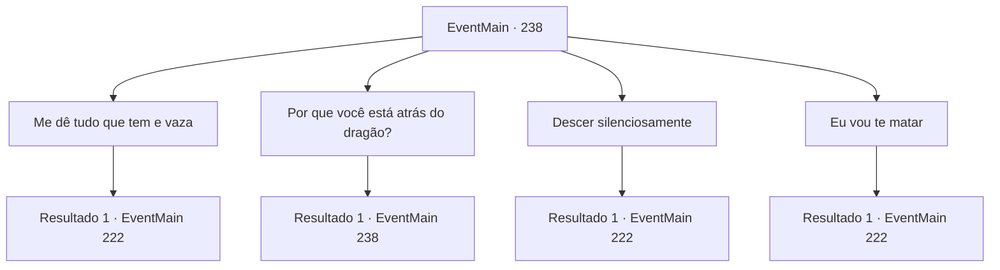

# Eventos principais · 238

[Índice da tabela](index.md) · [Índice geral](../index.md)

ID: `pt:EventMain:238` · Fonte: `EventMain4` · Versão: 1.2.47.

Mapeamento estático dos arquivos; a disponibilidade e a execução dependem do estado da run.

## Texto do evento

*Sem texto no arquivo.*

## Dados de entrada

```json
{
  "id": 238,
  "grade": 1,
  "normalGoal": "",
  "required": ""
}
```

## Mapa das escolhas



## Escolhas e resultados

### Escolha 1

Me dê tudo que tem e vaza

Requisitos e outros campos da escolha:

```json
{
  "required": ""
}
```

#### Resultado 1.1

Ele pega uma bolsa de moedas de ouro e a joga aos seus pés. Então ele desce a montanha, reunindo seus homens. Ao sair, ele grita 'Você vai se arrepender do que aconteceu hoje!'. Você pega a bolsa que ele deixou. Então você volta seu olhar para a porta surrada.

Continuação registrada: [Evento 222](0222.md) na mesma tabela.

```json
{
  "required": "",
  "chance": "1",
  "nextEvent": 222,
  "type": 2,
  "reward": "0_4_200|5_135_2"
}
```

### Escolha 2

Por que você está atrás do dragão?

Requisitos e outros campos da escolha:

```json
{
  "required": "5_135_0"
}
```

#### Resultado 2.1

Você pergunta a ele por que ele está perseguindo o dragão. Ele dá de ombros, então responde com uma voz arrogante. 

 "Bem, isso é porque aquele maldito dragão sequestrou minha noiva. Embora eu não tenha certeza se está realmente dentro daquela porta."


Continuação registrada: [Evento 238](0238.md) na mesma tabela.

```json
{
  "required": "",
  "chance": "1",
  "nextEvent": 238,
  "type": 2,
  "reward": "5_135_1"
}
```

### Escolha 3

Descer silenciosamente

Requisitos e outros campos da escolha:

```json
{
  "required": ""
}
```

#### Resultado 3.1

Você diz a Vertino para descer a montanha com seus cavaleiros. Sua expressão parece perplexa, mas faz o que você diz sem qualquer resposta. Você desvia o olhar deles para a porta surrada.

Continuação registrada: [Evento 222](0222.md) na mesma tabela.

```json
{
  "required": "",
  "chance": "1",
  "nextEvent": 222,
  "type": 2,
  "reward": "0_3_2|5_135_2"
}
```

### Escolha 4

Eu vou te matar

Requisitos e outros campos da escolha:

```json
{
  "required": "2_3_-10"
}
```

#### Resultado 4.1

Você saca sua arma e ataca a cabeça dele. O príncipe da nação vizinha, sem nenhuma expectativa de ser atacado, encontra seu fim assim. Você vira seu olhar para a porta surrada.

Continuação registrada: [Evento 222](0222.md) na mesma tabela.

```json
{
  "required": "",
  "chance": "1",
  "nextEvent": 222,
  "type": 2,
  "reward": "5_135_3|0_2_1|0_3_-5"
}
```

## Referências que chegam a este evento

- [Evento 237 · escolha 1 · resultado 1](0237.md#escolha-1)
- [Evento 238 · escolha 2 · resultado 1](0238.md#escolha-2)
