# Eventos principais · 239

[Índice da tabela](index.md) · [Índice geral](../index.md)

ID: `pt:EventMain:239` · Fonte: `EventMain4` · Versão: 1.2.47.

Mapeamento estático dos arquivos; a disponibilidade e a execução dependem do estado da run.

## Texto do evento

Um papagaio branco rodeia a sua cabeça antes de se sentar cuidadosamente no seu ombro. Limpa a sua garganta e - para a infelicidade dos seus ouvidos - berra. 

 "A princesa decidiu regressar ao palácio real. Estaremos à espera em 'Penate da Cabra Montanhosa', na abertura ocidental das Montanhas de Latnagar."

 Parece que Egakin mandou a mensagem. O papagaio, tendo entregue a sua mensagem, salta do seu ombro e voa em direção ao horizonte.

## Dados de entrada

```json
{
  "id": 239,
  "grade": 1,
  "normalGoal": "",
  "required": "13_2_5|1_2_65|18_135_3"
}
```

## Mapa das escolhas

```mermaid
flowchart TD
  E["EventMain · 239"]
  C0["Vá para &#x27;O Descanso da Cabra da Montanha&#x27;"]
  E --> C0
  R0_0["Resultado 1 · Destino especial -2"]
  C0 --> R0_0
  R0_1["Resultado 2 · Destino especial -2"]
  C0 --> R0_1
```



## Escolhas e resultados

### Escolha 1

Vá para 'O Descanso da Cabra da Montanha'

Requisitos e outros campos da escolha:

```json
{
  "required": ""
}
```

#### Resultado 1.1

Você se lembra de algo que leu em um livro. 'The Mountain Goat's Rest' é outro nome para a pequena cidade de 'Wafn', localizada no ponto inicial ocidental das Montanhas Latnagar. lugar para passar o outono e o inverno, depois de viajar pelas montanhas durante a primavera e o verão criando cabras. De qualquer forma, você segue para o Descanso da Cabra da Montanha, onde a princesa e Egakin devem estar esperando.

Continuação registrada: [Destino especial `-2`](../destinos-especiais.md).

```json
{
  "required": "1_7_12",
  "chance": "1",
  "nextEvent": -2,
  "type": 2,
  "reward": "13_2_6"
}
```

#### Resultado 1.2

Você não pode realmente dizer o que exatamente é um Descanso da Cabra da Montanha, mas você supõe que é algum tipo de cidade. Então você vai para aquela cidade, onde a princesa e Egakin devem estar esperando.

Continuação registrada: [Destino especial `-2`](../destinos-especiais.md).

```json
{
  "required": "2_7_12",
  "chance": "1",
  "nextEvent": -2,
  "type": 2,
  "reward": "13_2_6"
}
```

## Referências que chegam a este evento

Nenhum `nextEvent` positivo da mesma tabela aponta para este nó. Isso não prova que seja inacessível: sorteio e estado de história podem selecioná-lo.

