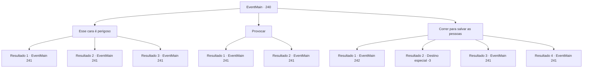

# Eventos principais · 240

[Índice da tabela](index.md) · [Índice geral](../index.md)

ID: `pt:EventMain:240` · Fonte: `EventMain4` · Versão: 1.2.47.

Mapeamento estático dos arquivos; a disponibilidade e a execução dependem do estado da run.

## Texto do evento

Chega-se ao 'Penate da Cabra Montanhosa', não parece ser um bom lugar para descansar. |drawing_burningCity| Em frente da pequena cidade envolta em chamas, você vê a princesa. Ela grite, e corre para a cidade em chamas. 

 "Temos de salvar o povo da cidade!"

 Logo, vários cavaleiros e um príncipe de cabelo ruivo bloqueia a princesa. Ele se apresenta gentilmente como Vertino, o príncipe de Arma, e fala. 

 "Este lugar é demasiado perigoso. Deixem o povo da cidade para os meus cavaleiros. Eu serei a vossa escolta até ao palácio real."

 Você nota o sangue pingando das espadas dos cavaleiros.

## Dados de entrada

```json
{
  "id": 240,
  "grade": 1,
  "normalGoal": "",
  "required": "13_2_6|1_2_75"
}
```

## Mapa das escolhas



## Escolhas e resultados

### Escolha 1

Esse cara é perigoso

Requisitos e outros campos da escolha:

```json
{
  "required": ""
}
```

#### Resultado 1.1

Você silenciosamente informa a princesa do perigo. Ela balança a cabeça, concordando com sua opinião. Ela então se vira para Vertino e fala. 

 "...Você cheira a sangue. Não posso confiar em gente como você. Saia do meu caminho. Prefiro ajudar as pessoas da cidade..."

 Ele interrompe a princesa, sua expressão se transformando em um sorriso frio. 

 "É assim que você cheira depois de passar um tempo nos campos de batalha. Ao contrário de outra pessoa, que foi criada em um mar de rosas por toda a vida. O que eu disse não foi uma oferta que você pode recusar. Se você não vier conosco, bem... teremos que levá-lo à força."

 Enquanto o príncipe gesticula, seus cavaleiros circulam em torno de você, Egakin e a princesa.

Continuação registrada: [Evento 241](0241.md) na mesma tabela.

```json
{
  "required": "",
  "chance": "1",
  "nextEvent": 241,
  "type": 2,
  "reward": ""
}
```

#### Resultado 1.2

Você silenciosamente informa a princesa do perigo. Ela balança a cabeça, concordando com sua opinião. Então, um velho foge do fogo. Ele é o velho pastor que você conheceu da última vez. 

 "Aquele... aquele bastardo ruivo matou todo mundo...!"

 Ele reúne todas as suas forças para entregar sua mensagem, então cai no chão. Os olhos da princesa ficam lacrimejantes, enquanto ela questiona Vertino. 

 "Por que... por que você fez isso?"

 A voz dela está trêmula. O príncipe responde com um sorriso enlouquecido no rosto. 

 "Por que isso importaria? Ah... droga. Graças a esse idiota, teremos que fazer isso da maneira mais difícil."

 Enquanto o príncipe gesticula, seus cavaleiros circulam em torno de você, Egakin e a princesa.

Continuação registrada: [Evento 241](0241.md) na mesma tabela.

```json
{
  "required": "5_140_1",
  "chance": "1",
  "nextEvent": 241,
  "type": 2,
  "reward": ""
}
```

#### Resultado 1.3

Você silenciosamente informa a princesa do perigo. Ela balança a cabeça, concordando com sua opinião. Então, um velho foge do fogo. Ele é o velho pastor que você conheceu da última vez. 

 "Aquele... aquele bastardo vermelho matou todo mundo...!"

 Ele reúne todas as suas forças para entregar sua mensagem, então cai no chão. Os olhos da princesa ficam lacrimejantes, enquanto ela questiona Vertino. 

 "Por que... por que você fez isso?"

 A voz dela está trêmula. O príncipe responde com um sorriso enlouquecido no rosto. 

 "Por que isso importaria? Ah... droga. Graças a esse idiota, terei que ser rude."

 Enquanto o príncipe gesticula, seus cavaleiros circulam em torno de você, Egakin e a princesa.

Continuação registrada: [Evento 241](0241.md) na mesma tabela.

```json
{
  "required": "5_140_2",
  "chance": "1",
  "nextEvent": 241,
  "type": 2,
  "reward": ""
}
```

### Escolha 2

Provocar

Requisitos e outros campos da escolha:

```json
{
  "required": "5_138_1"
}
```

#### Resultado 2.1

Você elabora um plano para se livrar da pretensão dele e diz que 'você não está apto como marido da princesa'. As veias na testa de Vertino saltam. Ele pergunta a princesa em voz baixa, rangendo os dentes. 

 "Haha... Certamente você não recusaria minha hospitalidade só por causa dessa 'coisa humilde'?"

 Mas ao contrário de sua expectativa, a princesa agarra sua mão. Isso veio para você como uma surpresa também. 

 "Esta pessoa não é uma 'coisa humilde', e nem eu confio em pessoas como você. Saia do meu caminho. Prefiro ajudar as pessoas da cidade..."

 Mas antes mesmo que ela termine, ele olha para seus cavaleiros e grita. <link=shake>

 "O que diabos você está esperando! Pegue todos!!"

</link> Como seu comando, seus cavaleiros circulam em torno de você, Egakin e a princesa.

Continuação registrada: [Evento 241](0241.md) na mesma tabela.

```json
{
  "required": "11_0_1",
  "chance": "1",
  "nextEvent": 241,
  "type": 2,
  "reward": "0_1_1"
}
```

#### Resultado 2.2

Você elabora um plano para se livrar de sua pretensão e agarra a mão da princesa, dizendo 'A princesa concordou em voltar ao palácio com minha companhia'. As veias na testa de Vertino saltam. Ele pergunta a princesa em voz baixa, rangendo os dentes. 

 "Haha... Certamente você não recusaria minha hospitalidade só por causa dessa 'coisa humilde'?"

 Mas ao contrário de sua expectativa, a princesa agarra sua mão. Isso veio para você como uma surpresa também. 

 "Esta pessoa não é uma 'coisa humilde', e nem eu confio em pessoas como você. Saia do meu caminho. Prefiro ajudar as pessoas da cidade..."

 Mas antes mesmo que ela termine, ele olha para seus cavaleiros e grita. <link=shake>

 "O que diabos você está esperando! Pegue todos!!"

</link> Como seu comando, seus cavaleiros circulam em torno de você, Egakin e a princesa.

Continuação registrada: [Evento 241](0241.md) na mesma tabela.

```json
{
  "required": "11_0_0",
  "chance": "1",
  "nextEvent": 241,
  "type": 2,
  "reward": "0_1_1"
}
```

### Escolha 3

Correr para salvar as pessoas

Requisitos e outros campos da escolha:

```json
{
  "required": "1_3_10"
}
```

#### Resultado 3.1

Você corre para a vila em chamas. O calor parece estar queimando sua pele, mas ainda assim você corre em busca de sobreviventes. Apesar de seu esforço, não há sobreviventes a serem encontrados. Você volta para a princesa, coberto de fuligem. Lá você vê uma cena inesperada, onde Egakin está lutando contra os cavaleiros.

Continuação registrada: [Evento 242](0242.md) na mesma tabela.

```json
{
  "required": "1_0_2",
  "chance": "1",
  "nextEvent": 242,
  "type": 2,
  "reward": "0_0_-1"
}
```

#### Resultado 3.2

Você corre para a vila em chamas. O calor parece estar queimando sua pele, mas ainda assim você corre em busca de sobreviventes. O ar quente sufoca você e você não consegue respirar. Por fim, você cai no chão, inconsciente. 

Continuação registrada: [Destino especial `-3`](../destinos-especiais.md).

```json
{
  "required": "2_0_2",
  "chance": "1",
  "nextEvent": -3,
  "type": 2,
  "reward": "0_0_-1"
}
```

#### Resultado 3.3

Você corre para a vila em chamas. O calor parece estar queimando sua pele, mas ainda assim você corre em busca de sobreviventes. Nesse momento, um velho grita do fogo e da fumaça. 

 "Aqui! Me tire daqui!!"

 Ele é o velho pastor que você conheceu da última vez. Você ajuda o velho a sair da cidade, enquanto ele aponta para Vertino e grita. 

 "Tosse! Tosse! Aquele... aquele bastardo ruivo matou todo mundo!"

 Os olhos da princesa ficam lacrimejantes, enquanto ela questiona Vertino. 

 "Por que... por que você fez isso?"

 A voz dela está trêmula. O príncipe responde com um sorriso enlouquecido no rosto. 

 "Por que isso importaria? Ah... droga. Graças a esse idiota, teremos que fazer isso da maneira mais difícil."

 Enquanto o príncipe gesticula, seus cavaleiros circulam ao seu redor, Egakin e a princesa. 

Continuação registrada: [Evento 241](0241.md) na mesma tabela.

```json
{
  "required": "5_140_1|1_0_2",
  "chance": "10",
  "nextEvent": 241,
  "type": 2,
  "reward": "0_3_5|0_0_-1"
}
```

#### Resultado 3.4

Você corre para a vila em chamas. O calor parece estar queimando sua pele, mas ainda assim você corre em busca de sobreviventes. Nesse momento, um velho grita do fogo e da fumaça. 

 "Aqui! Me tire daqui!!"

 Ele é o velho pastor que você conheceu da última vez. Você ajuda o velho a sair da cidade, enquanto ele aponta para Vertino e grita. 

 "Tosse! Tosse! Aquele... aquele bastardo ruivo matou todo mundo!"

 Os olhos da princesa ficam lacrimejantes, enquanto ela questiona Vertino. 

 "Por que... por que você fez isso?"

 A voz dela está trêmula. O príncipe responde com um sorriso enlouquecido no rosto. 

 "Por que isso importaria? Ah... droga. Graças a esse idiota, teremos que fazer isso da maneira mais difícil."

 Enquanto o príncipe gesticula, seus cavaleiros circulam ao seu redor, Egakin e a princesa. 

Continuação registrada: [Evento 241](0241.md) na mesma tabela.

```json
{
  "required": "5_140_2|1_0_2",
  "chance": "10",
  "nextEvent": 241,
  "type": 2,
  "reward": "0_3_5|0_0_-1"
}
```

## Referências que chegam a este evento

Nenhum `nextEvent` positivo da mesma tabela aponta para este nó. Isso não prova que seja inacessível: sorteio e estado de história podem selecioná-lo.

