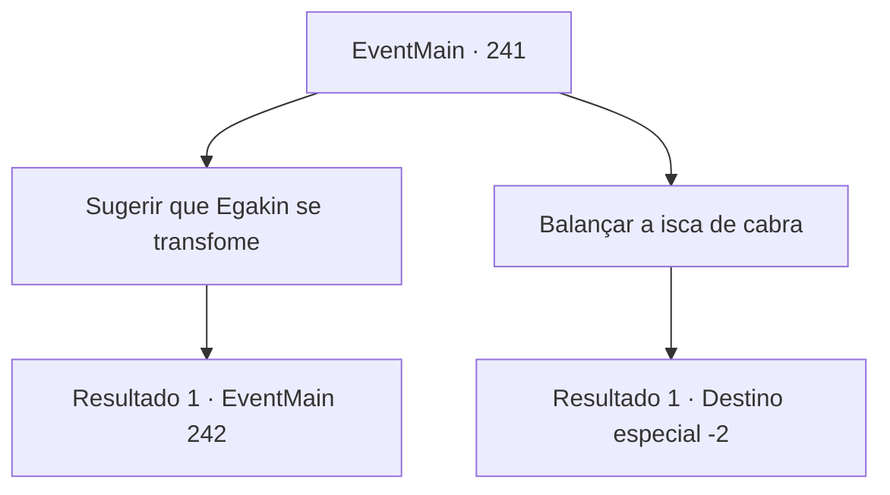

# Eventos principais · 241

[Índice da tabela](index.md) · [Índice geral](../index.md)

ID: `pt:EventMain:241` · Fonte: `EventMain4` · Versão: 1.2.47.

Mapeamento estático dos arquivos; a disponibilidade e a execução dependem do estado da run.

## Texto do evento

*Sem texto no arquivo.*

## Dados de entrada

```json
{
  "id": 241,
  "grade": 1,
  "normalGoal": "",
  "required": ""
}
```

## Mapa das escolhas



## Escolhas e resultados

### Escolha 1

Sugerir que Egakin se transfome

Requisitos e outros campos da escolha:

```json
{
  "required": ""
}
```

#### Resultado 1.1

Você silenciosamente sugere a Egakin que ele se transforme em sua forma original. 

 "A princesa está muito perto de mim. Se eu me transformar agora, vai machucá-la..."

 Enquanto vocês dois estão conversando, os cavaleiros estão se aproximando, suas lanças em punho.

Continuação registrada: [Evento 242](0242.md) na mesma tabela.

```json
{
  "required": "",
  "chance": "1",
  "nextEvent": 242,
  "type": 2,
  "reward": ""
}
```

### Escolha 2

Balançar a isca de cabra

Requisitos e outros campos da escolha:

```json
{
  "required": "5_140_1"
}
```

#### Resultado 2.1

Você puxa a isca de cabra e a sacode violentamente. A isca vermelha faz 'FRRT!' fazendo um barulho alto. Todos ao seu redor, incluindo o príncipe vizinho, olha para você com olhares confusos. 

 "Pff...! Fahahahaha!!! O que você está..."

 Antes que a risada de Vertino termine, o chão começa a tremer como se tivesse ocorrido um terremoto. Pouco depois, cabras gigantes da montanha aparecem de suas costas. <color=red><link=shake>

 "Bahhhhh--Bah---!!"

</link></color> Você rapidamente joga a isca para Vertino, e ele pega, confuso. Assim que a isca chega à sua mão, as cabras da montanha atacam ele e seus cavaleiros. A poeira cobre o ar, e os cavaleiros são arremessados ​​para o céu pelo rebanho de cabras. Alguns caem das falésias, e alguns estão espalhados pelo chão como marionetes sem cordas. Como você não pode ver nenhum sinal de Vertino, ele também deve ter caído do penhasco. A princesa olha para você por um momento e agradece. 

 "Ah... obrigado pela ajuda, {1}. Agora então... Vejo você na capital 'Zapen'. Tenho um lugar para visitar antes de retornar ao palácio."

 A princesa acena com a mão graciosamente, se despedindo de você.

Continuação registrada: [Destino especial `-2`](../destinos-especiais.md).

```json
{
  "required": "",
  "chance": "1",
  "nextEvent": -2,
  "type": 2,
  "reward": "13_2_8|15_3_7|5_135_3"
}
```

## Referências que chegam a este evento

- [Evento 240 · escolha 1 · resultado 1](0240.md#escolha-1)
- [Evento 240 · escolha 1 · resultado 2](0240.md#escolha-1)
- [Evento 240 · escolha 1 · resultado 3](0240.md#escolha-1)
- [Evento 240 · escolha 2 · resultado 1](0240.md#escolha-2)
- [Evento 240 · escolha 2 · resultado 2](0240.md#escolha-2)
- [Evento 240 · escolha 3 · resultado 3](0240.md#escolha-3)
- [Evento 240 · escolha 3 · resultado 4](0240.md#escolha-3)
