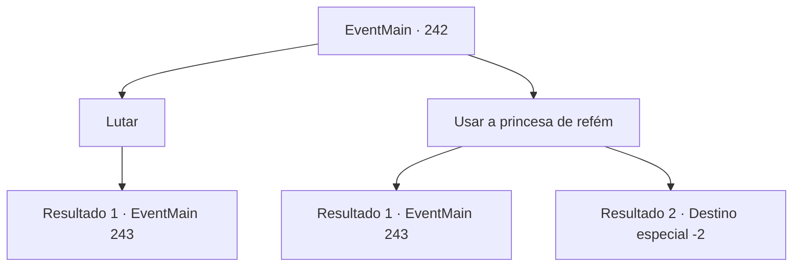

# Eventos principais · 242

[Índice da tabela](index.md) · [Índice geral](../index.md)

ID: `pt:EventMain:242` · Fonte: `EventMain4` · Versão: 1.2.47.

Mapeamento estático dos arquivos; a disponibilidade e a execução dependem do estado da run.

## Texto do evento

*Sem texto no arquivo.*

## Dados de entrada

```json
{
  "id": 242,
  "grade": 1,
  "normalGoal": "",
  "required": ""
}
```

## Mapa das escolhas



## Escolhas e resultados

### Escolha 1

Lutar

Requisitos e outros campos da escolha:

```json
{
  "required": ""
}
```

#### Resultado 1.1

Você saca sua arma, para romper os cavaleiros que o cercam.

Continuação registrada: [Evento 243](0243.md) na mesma tabela.

```json
{
  "required": "",
  "chance": "1",
  "nextEvent": 243,
  "type": 2,
  "reward": "6_0_92",
  "place": 4
}
```

### Escolha 2

Usar a princesa de refém

Requisitos e outros campos da escolha:

```json
{
  "required": ""
}
```

#### Resultado 2.1

Você pensa em um plano para romper os cavaleiros. Então você pega a princesa e grita: 'Chegue mais perto e a princesa será prejudicada'. Mas sua atuação desajeitada não engana ninguém. 

 "Faça aquele palhaço se ajoelhar diante de mim."

 Enquanto o príncipe ruivo dá sua ordem, os cavaleiros atacam você. Você guarda a princesa e apara os ataques. 

Continuação registrada: [Evento 243](0243.md) na mesma tabela.

```json
{
  "required": "",
  "chance": "14",
  "nextEvent": 243,
  "type": 1,
  "reward": "6_3_92",
  "place": 4
}
```

#### Resultado 2.2

Você pensa em um plano para romper os cavaleiros. Então você pega a princesa. Você grita 'Prefiro matar a princesa do que levá-la', estourando as veias do pescoço e olhando de soslaio com toda a força. Sua confiança é suficiente para assustar Vertino e seus cavaleiros, e Egakin percebe sua intenção e joga junto. 

 "Aquele... aquele filho da puta maluco..."

 Enquanto os cavaleiros estão tropeçando, você recua com a princesa. Depois de ficar cerca de 10 metros atrás, o corpo de Egakin começa a brilhar. |drawing_steeldragon| Então, com um rugido tremendo, os cavaleiros são lançados no ar. Isso envia alguns para os penhascos, e aqueles que não o fazem, fogem. Você assiste enquanto a cena se desenrola, ainda abraçando a princesa. Ela fica estupefata por um tempo antes de sair do seu alcance. 

 "...Obrigada. Pela ajuda."

 Ela diz para você encontrá-la em 'Zapen' como se ela estivesse sussurrando, e sai com Egakin.

Continuação registrada: [Destino especial `-2`](../destinos-especiais.md).

```json
{
  "required": "",
  "chance": "1|0_12_1",
  "nextEvent": -2,
  "type": 0,
  "reward": "13_2_8|5_135_3"
}
```

## Referências que chegam a este evento

- [Evento 240 · escolha 3 · resultado 1](0240.md#escolha-3)
- [Evento 241 · escolha 1 · resultado 1](0241.md#escolha-1)
