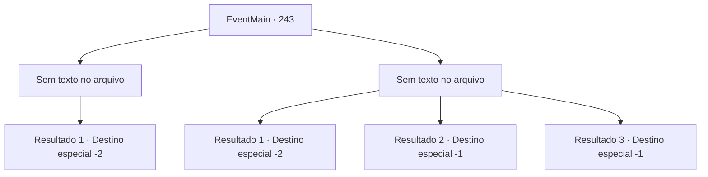

# Eventos principais · 243

[Índice da tabela](index.md) · [Índice geral](../index.md)

ID: `pt:EventMain:243` · Fonte: `EventMain4` · Versão: 1.2.47.

Mapeamento estático dos arquivos; a disponibilidade e a execução dependem do estado da run.

## Texto do evento

*Sem texto no arquivo.*

## Dados de entrada

```json
{
  "id": 243,
  "grade": 1,
  "normalGoal": "",
  "required": ""
}
```

## Mapa das escolhas



## Escolhas e resultados

### Escolha 1

*Sem texto no arquivo; o papel dessa opção depende da interface do jogo.*

Requisitos e outros campos da escolha:

```json
{
  "required": ""
}
```

#### Resultado 1.1

Você rompeu com sucesso a linha de defesa dos cavaleiros com Egakin. Depois de muito tempo correndo, quando você não consegue mais ver os cavaleiros, a princesa respira pesadamente e ri. 

 "*Uff*... *Uf*...! Eu... nunca corri assim. Isso... hein... é ótimo!"

 Ela continua inspirando e expirando por um tempo sem dizer nada. Depois de recuperar o fôlego novamente, ela agradece. 

 "Hoo... Agradeço muito pela ajuda, {1}. Vejo você na capital 'Zapen'. Tenho um lugar para visitar antes de retornar ao palácio."

 Ela se despede de você, limpando seu suor.

Continuação registrada: [Destino especial `-2`](../destinos-especiais.md).

```json
{
  "required": "",
  "chance": "1",
  "nextEvent": -2,
  "type": 2,
  "reward": "13_2_8"
}
```

### Escolha 2

*Sem texto no arquivo; o papel dessa opção depende da interface do jogo.*

Requisitos e outros campos da escolha:

```json
{
  "required": ""
}
```

#### Resultado 2.1

Você quase é pego pelos cavaleiros, mas consegue escapar deles. Depois de muito tempo correndo, quando você não consegue mais ver os cavaleiros, a princesa respira pesadamente e ri. 

 "*Uff*... *Uf*...! Eu... nunca corri assim. Isso... hein... é ótimo!"

 Ela continua inspirando e expirando por um tempo sem dizer nada. Depois de recuperar o fôlego novamente, ela agradece. 

 "Hoo... Agradeço muito pela ajuda, {1}. Vejo você na capital 'Zapen'. Tenho um lugar para visitar antes de retornar ao palácio."

 Ela se despede de você, limpando seu suor.

Continuação registrada: [Destino especial `-2`](../destinos-especiais.md).

```json
{
  "required": "1_0_2|1_1_2",
  "chance": "1",
  "nextEvent": -2,
  "type": 2,
  "reward": "13_2_8"
}
```

#### Resultado 2.2

Egakin e a princesa conseguiram escapar pela linha de defesa, mas você não. O príncipe ruivo se aproxima de você, agora subjugado por seus cavaleiros. Ele pega uma adaga e começa a tocá-la. 

 "Você deveria saber o seu lugar, verme. Você ousa me desafiar?"

 Depois de terminar, ele lentamente coloca sua adaga em seu pescoço. Com a sensação da lâmina fria cortando sua carne, você perde a consciência.

Continuação registrada: [Destino especial `-1`](../destinos-especiais.md).

```json
{
  "required": "2_0_2",
  "chance": "1",
  "nextEvent": -1,
  "type": 2,
  "reward": "15_3_1|0_0_-1|0_1_-1"
}
```

#### Resultado 2.3

Egakin e a princesa conseguiram escapar pela linha de defesa, mas você não. O príncipe ruivo se aproxima de você, agora subjugado por seus cavaleiros. Ele pega uma adaga e começa a tocá-la. 

 "Você deveria saber o seu lugar, verme. Você ousa me desafiar?"

 Depois de terminar, ele lentamente coloca sua adaga em seu pescoço. Com a sensação da lâmina fria cortando sua carne, você perde a consciência.

Continuação registrada: [Destino especial `-1`](../destinos-especiais.md).

```json
{
  "required": "2_1_2",
  "chance": "1",
  "nextEvent": -1,
  "type": 2,
  "reward": "15_3_1|0_0_-1|0_1_-1"
}
```

## Referências que chegam a este evento

- [Evento 242 · escolha 1 · resultado 1](0242.md#escolha-1)
- [Evento 242 · escolha 2 · resultado 1](0242.md#escolha-2)
