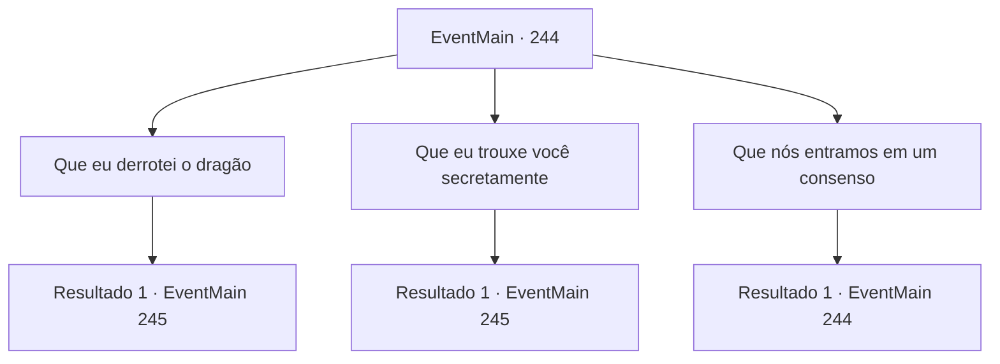

# Eventos principais · 244

[Índice da tabela](index.md) · [Índice geral](../index.md)

ID: `pt:EventMain:244` · Fonte: `EventMain4` · Versão: 1.2.47.

Mapeamento estático dos arquivos; a disponibilidade e a execução dependem do estado da run.

## Texto do evento

Voltas à capital do império 'Zapen', onde tua aventura começou. Assim que passa pela entrada da cidade, alguém com um manto se aproxima de você. 

 "Venha."

 Percebendo que a voz é de Egakin. vocêo segue para um quarto nos fundos de uma estalagem, onde Esit está calmamente bebendo chá. 

 "Bem-vindo. Esperei bastante por esse momento. Pensei que devíamos decidir com antecedência, a história por trás da derrota do dragão."


## Dados de entrada

```json
{
  "id": 244,
  "grade": 1,
  "normalGoal": "",
  "required": "13_2_8|1_2_100"
}
```

## Mapa das escolhas



## Escolhas e resultados

### Escolha 1

Que eu derrotei o dragão

Requisitos e outros campos da escolha:

```json
{
  "required": ""
}
```

#### Resultado 1.1

Você sugere que eles digam que você conseguiu derrotar o dragão e trouxe a princesa de volta. Egakin diz que entrará algum tempo depois, já que entrar junto com a princesa pode levantar suspeitas. Então você vai para o palácio real com a princesa. O guarda no portão do castelo a reconhece e abre o portão imediatamente. Você segue a princesa até a corte do Imperador. |drawing_emperor| Ele está usando anéis feitos de joias diferentes em cada um de seus dedos, exceto um, que ele roubou dos imperadores dos impérios que conquistou. Você cumprimenta o Imperador, ajoelhando-se na frente dele. Então você diz que derrotou o dragão e salvou a princesa. O Imperador olha para a princesa e pergunta se a história é verdadeira, e ela responde que sim. 

 "Eu vejo. Agradeço-lhe pessoalmente por salvar meu tesouro. Eu gostaria de passar algum tempo com minha filha sozinha, então, por favor, nos dê licença por um segundo."

 Enquanto o Imperador gesticula, uma empregada se aproxima de você. Você a segue até o quarto de hóspedes.

Continuação registrada: [Evento 245](0245.md) na mesma tabela.

```json
{
  "required": "",
  "chance": "1",
  "nextEvent": 245,
  "type": 2,
  "reward": "5_151_1"
}
```

### Escolha 2

Que eu trouxe você secretamente

Requisitos e outros campos da escolha:

```json
{
  "required": ""
}
```

#### Resultado 2.1

Você sugere que eles digam que você conseguiu secretamente tirar a princesa do covil. Egakin diz que entrará algum tempo depois, já que entrar junto com a princesa pode levantar suspeitas. Então você vai para o palácio real com a princesa. O guarda no portão do castelo a reconhece e abre o portão imediatamente. Você segue a princesa até a corte do Imperador. |drawing_emperor| Ele está usando anéis feitos de joias diferentes em cada um de seus dedos, exceto um, que ele roubou dos imperadores dos impérios que conquistou. Você cumprimenta o Imperador, ajoelhando-se na frente dele. Então você diz que tirou a princesa do dragão sem que ele percebesse. O Imperador olha para a princesa e pergunta se a história é verdadeira, e ela responde que sim. 

 "Eu vejo. Agradeço-lhe pessoalmente por salvar meu tesouro. Eu gostaria de passar algum tempo com minha filha sozinha, então, por favor, nos dê licença por um segundo."

 Enquanto o Imperador gesticula, uma empregada se aproxima de você. Você a segue até o quarto de hóspedes.

Continuação registrada: [Evento 245](0245.md) na mesma tabela.

```json
{
  "required": "",
  "chance": "1",
  "nextEvent": 245,
  "type": 2,
  "reward": "5_151_2"
}
```

### Escolha 3

Que nós entramos em um consenso

Requisitos e outros campos da escolha:

```json
{
  "required": "5_150_0"
}
```

#### Resultado 3.1

Você sugere que eles digam que você conseguiu persuadir o dragão e trazer a princesa de volta, mas a princesa responde decisivamente. 

 "Não. Não há como Sua Majestade acreditar em tal coisa. Ele definitivamente vai questionar tudo... por que o dragão me sequestrou, o que você deu em troca de mim, se você escreveu um contrato para a transação, etc... Estaríamos melhor com um plano diferente. Algo que ele possa entender facilmente."


Continuação registrada: [Evento 244](0244.md) na mesma tabela.

```json
{
  "required": "",
  "chance": "1",
  "nextEvent": 244,
  "type": 2,
  "reward": "5_150_1"
}
```

## Referências que chegam a este evento

- [Evento 244 · escolha 3 · resultado 1](0244.md#escolha-3)
