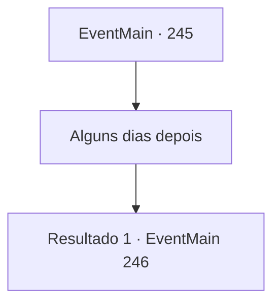

# Eventos principais · 245

[Índice da tabela](index.md) · [Índice geral](../index.md)

ID: `pt:EventMain:245` · Fonte: `EventMain4` · Versão: 1.2.47.

Mapeamento estático dos arquivos; a disponibilidade e a execução dependem do estado da run.

## Texto do evento

*Sem texto no arquivo.*

## Dados de entrada

```json
{
  "id": 245,
  "grade": 1,
  "normalGoal": "",
  "required": ""
}
```

## Mapa das escolhas



## Escolhas e resultados

### Escolha 1

Alguns dias depois

Requisitos e outros campos da escolha:

```json
{
  "required": ""
}
```

#### Resultado 1.1

Ao contrário do que ele disse, o Imperador faz você esperar vários dias. Como você está ficando cansado de esperar, uma empregada abre sua porta e entra. 

 "Sua Majestade chama você."

 Ela fala de uma maneira muito clerical e leva você para a sala de audiência. O Imperador é ladeado pelos membros do palácio, incluindo a princesa. Você se ajoelha diante do Imperador pela segunda vez e o cumprimenta. 

 "Você resgatou a princesa, então me diga. Qual o seu desejo?"


Continuação registrada: [Evento 246](0246.md) na mesma tabela.

```json
{
  "required": "",
  "chance": "1",
  "nextEvent": 246,
  "type": 2,
  "reward": ""
}
```

## Referências que chegam a este evento

- [Evento 244 · escolha 1 · resultado 1](0244.md#escolha-1)
- [Evento 244 · escolha 2 · resultado 1](0244.md#escolha-2)
