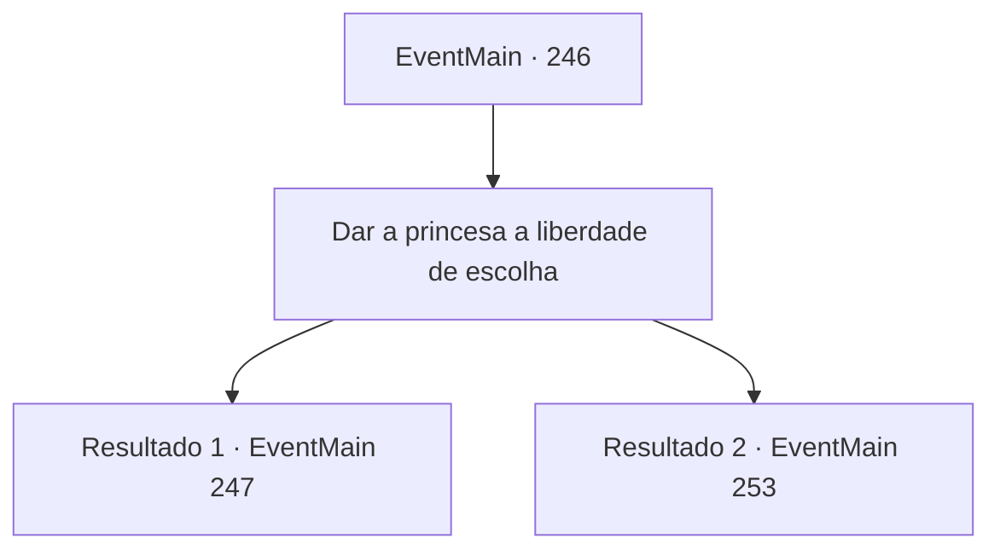

# Eventos principais · 246

[Índice da tabela](index.md) · [Índice geral](../index.md)

ID: `pt:EventMain:246` · Fonte: `EventMain4` · Versão: 1.2.47.

Mapeamento estático dos arquivos; a disponibilidade e a execução dependem do estado da run.

## Texto do evento

*Sem texto no arquivo.*

## Dados de entrada

```json
{
  "id": 246,
  "grade": 1,
  "normalGoal": "",
  "required": ""
}
```

## Mapa das escolhas



## Escolhas e resultados

### Escolha 1

Dar a princesa a liberdade de escolha

Requisitos e outros campos da escolha:

```json
{
  "required": ""
}
```

#### Resultado 1.1

O Imperador parece perdido em pensamentos e levanta as costas em seu trono, falando. 

 "Não é que eu não acredite no que você e a princesa disseram, mas as palavras não são suficientes. Se você realmente derrotou o dragão, traga sua cabeça para mim. Faça isso e seu desejo será concedido."

 Depois de terminar, o Imperador gesticula para você sair. A princesa, depois de sair da sala de audiência com você, diz com um olhar preocupado. 

 "Parece que Sua Majestade não tem intenção de desistir do casamento diplomático..."


Continuação registrada: [Evento 247](0247.md) na mesma tabela.

```json
{
  "required": "5_151_1",
  "chance": "1",
  "nextEvent": 247,
  "type": 2,
  "reward": ""
}
```

#### Resultado 1.2

O Imperador parece perdido em pensamentos e levanta as costas em seu trono, falando. 

 "Ainda não estou convencido de que a princesa esteja realmente a salvo do dragão. Mate o dragão e traga provas. Faça isso e seu desejo será concedido."

 O Imperador sai da sala de audiência depois de terminar. Outros membros do palácio seguem o Imperador para fora da sala, e depois que todos saem, a princesa vem até você. 

 "Parece que Sua Majestade não tem intenção de desistir do casamento diplomático... A segurança tem sido ainda mais rigorosa desde a última vez, então mesmo se eu perguntar a Egakin, seria difícil sair..."


Continuação registrada: [Evento 253](0253.md) na mesma tabela.

```json
{
  "required": "5_151_2",
  "chance": "1",
  "nextEvent": 253,
  "type": 2,
  "reward": ""
}
```

## Referências que chegam a este evento

- [Evento 245 · escolha 1 · resultado 1](0245.md#escolha-1)
