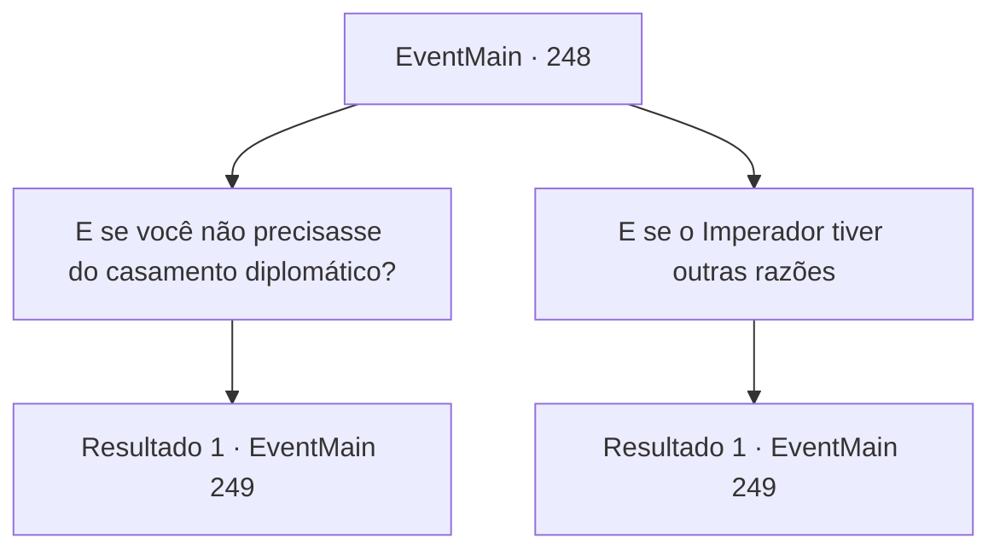

# Eventos principais · 248

[Índice da tabela](index.md) · [Índice geral](../index.md)

ID: `pt:EventMain:248` · Fonte: `EventMain4` · Versão: 1.2.47.

Mapeamento estático dos arquivos; a disponibilidade e a execução dependem do estado da run.

## Texto do evento

*Sem texto no arquivo.*

## Dados de entrada

```json
{
  "id": 248,
  "grade": 1,
  "normalGoal": "",
  "required": ""
}
```

## Mapa das escolhas



## Escolhas e resultados

### Escolha 1

E se você não precisasse do casamento diplomático?

Requisitos e outros campos da escolha:

```json
{
  "required": ""
}
```

#### Resultado 1.1

Você pergunta a ela o que ela gostaria de fazer se ela obtivesse a liberdade do casamento. Ela responde com um leve sorriso. 

 "Nós iremos. Não posso dizer com certeza agora, mas se isso acontecer... quero me casar com alguém sábio. Alguém que possa me entender, alguém que possa me dar conselhos sábios para mim."

 Então, a porta se abre e Egakin entra. Ele tira uma armadura brilhando com uma luz azulada de uma mochila de couro. Enquanto a princesa lhe pergunta o que é com os olhos bem abertos, Egakin fala com um sorriso satisfatório. 

 "Esta é uma armadura feita de meus chifres e escamas, forjada há algum tempo por anões. Como evidência de derrotar um dragão, isso será suficiente."

 Ele lhe entrega a armadura, dizendo para presenteá-la ao Imperador.

Continuação registrada: [Evento 249](0249.md) na mesma tabela.

```json
{
  "required": "",
  "chance": "1",
  "nextEvent": 249,
  "type": 2,
  "reward": "3_197_1"
}
```

### Escolha 2

E se o Imperador tiver outras razões

Requisitos e outros campos da escolha:

```json
{
  "required": ""
}
```

#### Resultado 2.1

A princesa responde à sua pergunta com um 'Hmm...', franzindo a testa. Ela cruza os braços e se inclina para trás, e pensa brevemente antes de finalmente falar. 

 "É com isso que eu também estou preocupado..."

 Enquanto você e a princesa estão perdidos em pensamentos, a porta se abre e Egakin entra. Ele tira uma armadura brilhando com uma luz azulada de uma mochila de couro. Enquanto a princesa lhe pergunta o que é com os olhos bem abertos, Egakin fala com um sorriso satisfatório. 

 "Esta é uma armadura feita de meus chifres e escamas, forjada há algum tempo por anões. Como evidência de derrotar um dragão, isso será suficiente."

 Ele lhe entrega a armadura, dizendo para presenteá-la ao Imperador.

Continuação registrada: [Evento 249](0249.md) na mesma tabela.

```json
{
  "required": "",
  "chance": "1",
  "nextEvent": 249,
  "type": 2,
  "reward": "3_197_1"
}
```

## Referências que chegam a este evento

- [Evento 247 · escolha 1 · resultado 1](0247.md#escolha-1)
