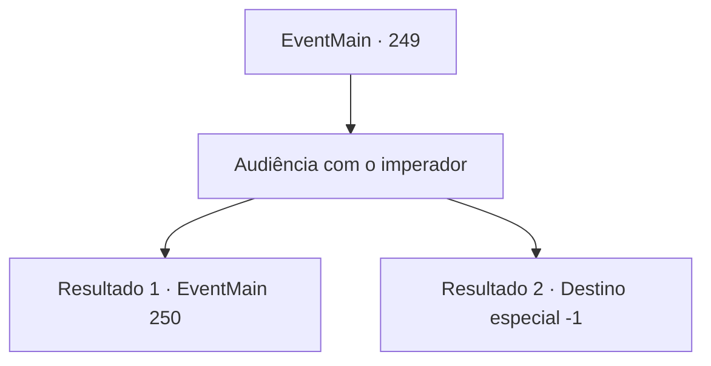

# Eventos principais · 249

[Índice da tabela](index.md) · [Índice geral](../index.md)

ID: `pt:EventMain:249` · Fonte: `EventMain4` · Versão: 1.2.47.

Mapeamento estático dos arquivos; a disponibilidade e a execução dependem do estado da run.

## Texto do evento

*Sem texto no arquivo.*

## Dados de entrada

```json
{
  "id": 249,
  "grade": 1,
  "normalGoal": "",
  "required": ""
}
```

## Mapa das escolhas



## Escolhas e resultados

### Escolha 1

Audiência com o imperador

Requisitos e outros campos da escolha:

```json
{
  "required": ""
}
```

#### Resultado 1.1

Você vai para a sala de audiência e dá ao Imperador a armadura de escamas de dragão. Ele o pega e inspeciona aqui e ali, até mesmo golpeando-o com uma espada. Como a lâmina da espada é quebrada com um único golpe, ele mostra um sorriso satisfatório. 

 "De fato... parece que isso é feito de escamas de dragão, afinal. Multar. Eu vou acreditar no que você disse."

 Ele joga a espada sem lâmina de lado e anuncia aos membros do palácio. 

 "Eu devo, como {1} desejar, não forçar o casamento da princesa."

 O Imperador pega a armadura e sai da sala de audiências. Depois que todos saíram da sala, a princesa se aproxima de você, como se estivesse esperando para dizer alguma coisa. 

Continuação registrada: [Evento 250](0250.md) na mesma tabela.

```json
{
  "required": "5_135_3",
  "chance": "1",
  "nextEvent": 250,
  "type": 2,
  "reward": "4_197_1|15_3_2"
}
```

#### Resultado 1.2

Você vai para a sala de audiência e dá ao Imperador a armadura de escamas de dragão. Ele o pega e inspeciona aqui e ali, até mesmo golpeando-o com uma espada. Como a lâmina da espada é quebrada com um único golpe, ele mostra um sorriso satisfatório. 

 "De fato... parece que isso é feito de escamas de dragão, afinal. Multar. Eu vou acreditar no que você disse."

 Ele joga a espada sem lâmina de lado e anuncia aos membros do palácio. 

 "Eu devo, como {1} desejar, dar à Princesa Esit o direito de decidir seu marido."

 Então, ele acrescenta, levantando o dedo. 

 "Mas esse direito deve ser dado a ela daqui a 100 anos. Quanto a esse, prenda-o até que eles possam ver seu desejo se tornar realidade."

 A princesa grita 'Isso é absurdo!', mas o Imperador ignora. Os guardas correm até você e o amarram com uma corda, e você é trancado em uma prisão. Algum tempo passa e a princesa visita você. Ela fala com você, seus olhos lacrimejantes. 

 "Desculpe... Tudo isso por causa da minha ganância... Eu vou te tirar daqui, aconteça o que acontecer."

 Ela vai embora, pedindo que você acredite nela.

Continuação registrada: [Destino especial `-1`](../destinos-especiais.md).

```json
{
  "required": "18_135_3",
  "chance": "1",
  "nextEvent": -1,
  "type": 2,
  "reward": "15_3_5|15_3_9|4_197_1"
}
```

## Referências que chegam a este evento

- [Evento 248 · escolha 1 · resultado 1](0248.md#escolha-1)
- [Evento 248 · escolha 2 · resultado 1](0248.md#escolha-2)
