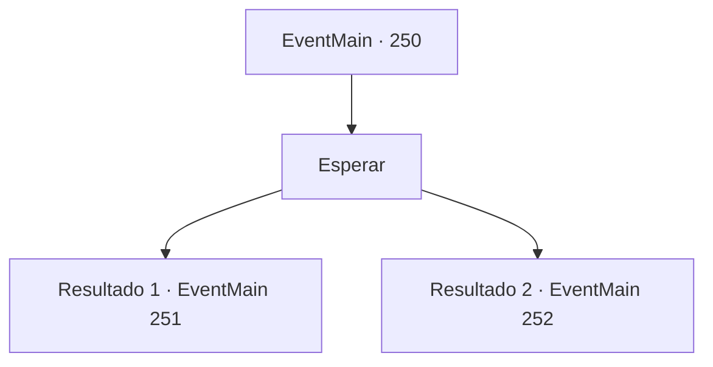

# Eventos principais · 250

[Índice da tabela](index.md) · [Índice geral](../index.md)

ID: `pt:EventMain:250` · Fonte: `EventMain4` · Versão: 1.2.47.

Mapeamento estático dos arquivos; a disponibilidade e a execução dependem do estado da run.

## Texto do evento

*Sem texto no arquivo.*

## Dados de entrada

```json
{
  "id": 250,
  "grade": 1,
  "normalGoal": "",
  "required": ""
}
```

## Mapa das escolhas



## Escolhas e resultados

### Escolha 1

Esperar

Requisitos e outros campos da escolha:

```json
{
  "required": ""
}
```

#### Resultado 1.1

Você espera a princesa falar. Depois de hesitar um pouco, ela fala, corando. 

 "Ahem... Ao invés de apenas agradecer com palavras, eu queria enviar uma mensagem mais forte. Então eu tenho uma coisinha aqui. Você vai ficar junto comigo de agora em diante?"

 Ela revela as mãos e lhe dá uma pequena caixa. Dentro da caixa há um anel de ouro puro, decorado com rubi.

Continuação registrada: [Evento 251](0251.md) na mesma tabela.

```json
{
  "required": "11_0_0",
  "chance": "1",
  "nextEvent": 251,
  "type": 2,
  "reward": ""
}
```

#### Resultado 1.2

Você espera a princesa falar. Ela revela as mãos e lhe dá uma pequena caixa. 

 "Achei que deveria comprar alguma coisa, já que não saio do castelo com frequência. Me incomodaria apenas agradecer... Eu quero você perto de mim o tempo todo a partir de agora."

 Dentro da caixa há um broche de platina, decorado com peridoto.

Continuação registrada: [Evento 252](0252.md) na mesma tabela.

```json
{
  "required": "11_0_1",
  "chance": "1",
  "nextEvent": 252,
  "type": 2,
  "reward": ""
}
```

## Referências que chegam a este evento

- [Evento 249 · escolha 1 · resultado 1](0249.md#escolha-1)
