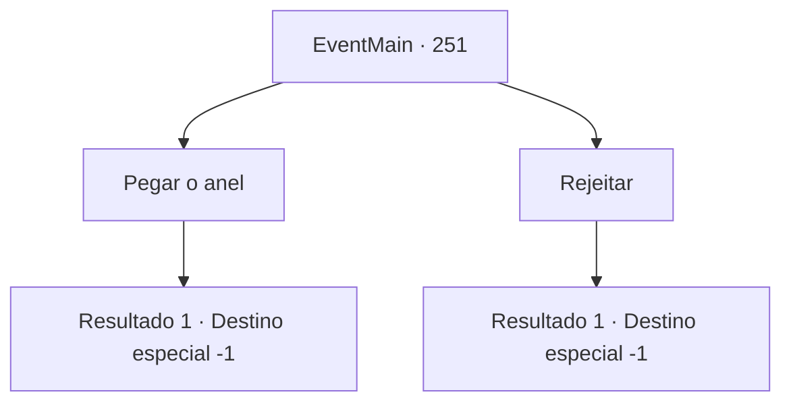

# Eventos principais · 251

[Índice da tabela](index.md) · [Índice geral](../index.md)

ID: `pt:EventMain:251` · Fonte: `EventMain4` · Versão: 1.2.47.

Mapeamento estático dos arquivos; a disponibilidade e a execução dependem do estado da run.

## Texto do evento

*Sem texto no arquivo.*

## Dados de entrada

```json
{
  "id": 251,
  "grade": 1,
  "normalGoal": "",
  "required": ""
}
```

## Mapa das escolhas



## Escolhas e resultados

### Escolha 1

Pegar o anel

Requisitos e outros campos da escolha:

```json
{
  "required": ""
}
```

#### Resultado 1.1

Você pega o anel de rubi que ela te deu. Você e a princesa ficam noivos, colocando o anel nos dedos um do outro. Ela diz com um sorriso agora confiante. 

 "Hehe... Sua Majestade vai se assustar quando lhe dermos a notícia. Haverá muitas dificuldades à nossa frente. Acho que você também verá os aspectos mais sombrios da sociedade real. Mas ainda assim... estou ansioso por isso."

 Ela te abraça. E assim, sua jornada para salvar a princesa chega ao seu capítulo final. 

Continuação registrada: [Destino especial `-1`](../destinos-especiais.md).

```json
{
  "required": "",
  "chance": "1",
  "nextEvent": -1,
  "type": 2,
  "reward": "15_3_6|3_193_1"
}
```

### Escolha 2

Rejeitar

Requisitos e outros campos da escolha:

```json
{
  "required": ""
}
```

#### Resultado 2.1

Você rejeita a proposta da princesa. Seu rosto mostra que ela está perplexa. 

 "Uhh... isso é uma surpresa. Eu não esperava que você recusasse..."

 Ela inclina a cabeça para a frente por um tempo e murmura para si mesma em uma voz inaudível. Então, ela levanta a cabeça novamente, como se tivesse tomado uma decisão. 

 "Multar. Mas, a parte em que eu quero que você fique ao meu lado não muda. Preciso de alguém para me aconselhar. E... eu não vou desistir assim."

 Ela retira a mão com o anel e sai da sala de audiências.

Continuação registrada: [Destino especial `-1`](../destinos-especiais.md).

```json
{
  "required": "",
  "chance": "1",
  "nextEvent": -1,
  "type": 2,
  "reward": "15_3_4"
}
```

## Referências que chegam a este evento

- [Evento 250 · escolha 1 · resultado 1](0250.md#escolha-1)
