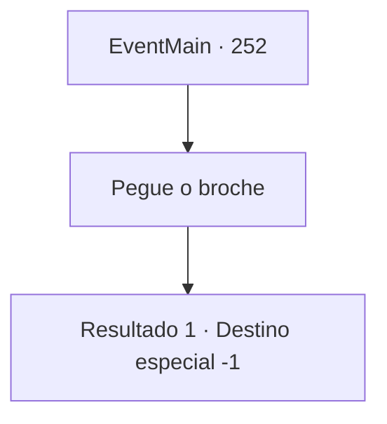

# Eventos principais · 252

[Índice da tabela](index.md) · [Índice geral](../index.md)

ID: `pt:EventMain:252` · Fonte: `EventMain4` · Versão: 1.2.47.

Mapeamento estático dos arquivos; a disponibilidade e a execução dependem do estado da run.

## Texto do evento

*Sem texto no arquivo.*

## Dados de entrada

```json
{
  "id": 252,
  "grade": 1,
  "normalGoal": "",
  "required": ""
}
```

## Mapa das escolhas



## Escolhas e resultados

### Escolha 1

Pegue o broche

Requisitos e outros campos da escolha:

```json
{
  "required": ""
}
```

#### Resultado 1.1

Você pega o broche que ela te deu. Ela diz com um sorriso agora confiante. 

 "Hehe... cai bem em você. Haverá muitas dificuldades à nossa frente. Acho que você também verá os aspectos mais sombrios da sociedade real. Mas ainda assim... estou ansioso por isso."

 Ela te abraça. E assim, sua jornada para salvar a princesa chega ao seu capítulo final.

Continuação registrada: [Destino especial `-1`](../destinos-especiais.md).

```json
{
  "required": "",
  "chance": "1",
  "nextEvent": -1,
  "type": 2,
  "reward": "15_3_8|3_194_1"
}
```

## Referências que chegam a este evento

- [Evento 250 · escolha 1 · resultado 2](0250.md#escolha-1)
